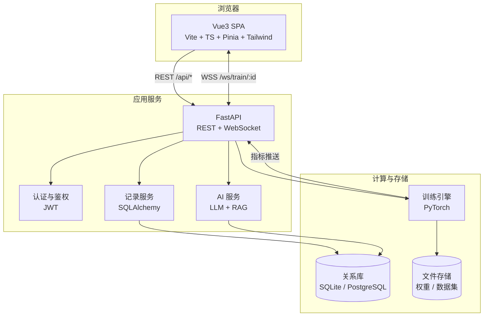
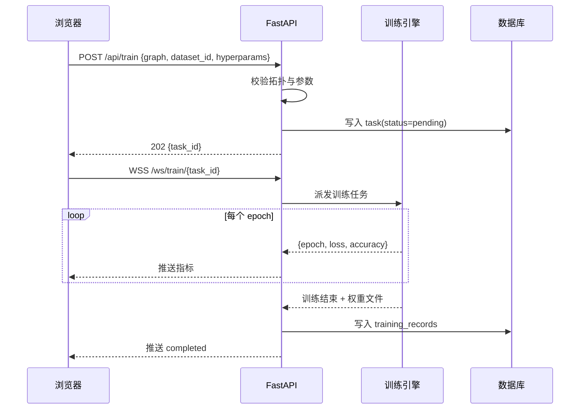
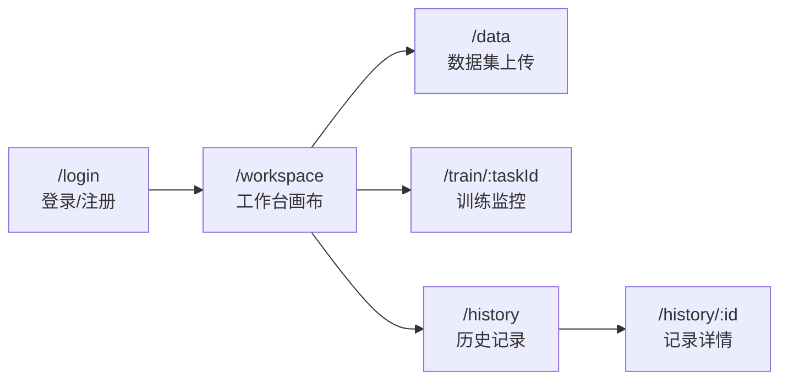
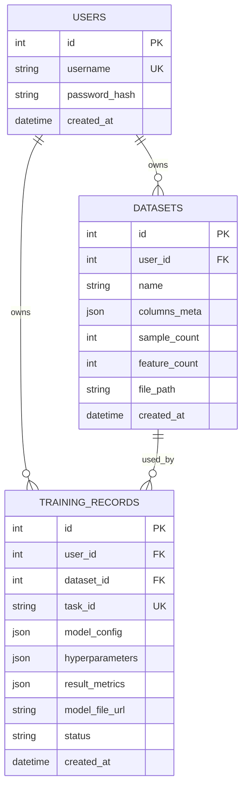

# DeepVision 设计文档

> **可视化深度学习实验平台** ｜ 版本 v3.0 ｜ 状态：草案
> 最后更新：2026-10-18

## 目录

1. [项目概述](#1-项目概述)
2. [产品范围](#2-产品范围)
3. [系统架构](#3-系统架构)
4. [视觉设计系统](#4-视觉设计系统)
5. [页面规格](#5-页面规格)
6. [数据模型](#6-数据模型)
7. [接口契约](#7-接口契约)
8. [阶段实施计划（开发任务书）](#8-阶段实施计划开发任务书)
9. [非功能需求](#9-非功能需求)
10. [风险与对策](#10-风险与对策)
11. [第二大阶段：3D 可视化与智能调参](#11-第二大阶段3d-可视化与智能调参)
12. [变更记录](#12-变更记录)

---

## 1. 项目概述

### 1.1 项目定位

DeepVision 是面向深度学习初学者与教学场景的**可视化神经网络实验平台**。用户无需编写代码，即可拖拽搭建网络、上传数据集、实时观察训练过程，并获得 LLM 助教的结构与超参数建议。

**一句话定位**：把「搭网络 + 看训练」从代码里搬到画布上。

### 1.2 目标用户与痛点

| 用户类型 | 核心诉求 | 现状痛点 |
| --- | --- | --- |
| 深度学习初学者 | 建立对网络结构与训练过程的直觉 | 概念抽象，无法感知数据在层间流动 |
| 高校学生 / 教师 | 课堂演示、对照实验 | 代码门槛高，现场演示效果差 |
| 算法工程师 | 快速验证网络结构 | 搭环境、写样板代码占用大量时间 |

### 1.3 核心价值主张

1. **可视化搭建** —— 拖拽即得网络拓扑，画布即数据源。
2. **过程可见** —— 训练实时动画，前向 / 反向传播可被「看见」。
3. **AI 协同** —— LLM 诊断结构合理性，输出可一键应用的修改建议。

### 1.4 名词约定

| 术语 | 含义 |
| --- | --- |
| 拓扑（Graph） | 画布中的节点与连线，序列化为 JSON |
| 节点（Node） | 网络的一层，含类型与参数 |
| 训练任务（Task） | 一次完整的训练执行，有独立 `task_id` |
| 训练记录（Record） | 训练任务结束后落库的持久化数据 |

---

## 2. 产品范围

### 2.1 范围内（首版）

| 阶段 | 能力 |
| --- | --- |
| 一 | 用户认证、训练记录持久化 |
| 二 | 拖拽式拓扑搭建与可视化 |
| 三 | CSV 上传、解析与预处理 |
| 四 | 训练过程实时可视化 |
| 五 | LLM 助教与 Agent 调参建议 |

### 2.2 范围外（Non-goals）

明确不做，避免范围蔓延：

- **不做生产级分布式训练**：单机单进程，仅用于教学与验证。
- **不做完整 AutoML**：仅基于 LLM 给出建议，不做自动搜索。
- **不做特殊层类型**：节点均为全连接层（激活函数 ReLU / Sigmoid / Tanh），但拓扑支持任意前馈 DAG——分支与汇合均可训练，汇合按特征维 `concat` 合并。CNN / RNN 等特殊层类型列为后续版本。
- **不做图像 / 文本数据集**：首版仅支持 CSV 表格数据。
- **不做移动端 App**：仅提供响应式 Web，最小支持宽度 1280px。
- **不做模型部署与推理服务**：训练产物仅提供下载。

---

## 3. 系统架构

### 3.1 总体架构



### 3.2 技术选型

| 层 | 技术 | 版本 | 选型理由 |
| --- | --- | --- | --- |
| 前端框架 | Vue 3 + TypeScript | 3.4+ | Composition API，类型友好 |
| 构建 | Vite | 5+ | 冷启动与 HMR 快 |
| 状态 | Pinia | 2+ | 官方方案，模块化清晰 |
| 样式 | TailwindCSS | 3+ | Design Token 可直接映射为配置 |
| 图可视化 | 自研 SVG（v1） | — | 交互与样式完全可控，规避 G6 v5 的 API 变动风险 |
| 3D 渲染 | Three.js（第二大阶段引入） | — | 发光球体、权重驱动连线、激活呼吸动画 |
| 图表 | ECharts | 5+ | 双轴折线、实时数据更新成熟 |
| 请求 | Axios | 1+ | 拦截器便于统一鉴权与错误处理 |
| CSV 解析 | 自研解析器（`utils/csv.ts`） | — | 规避 npm 依赖安装问题；覆盖引号、转义、字段内换行、CRLF、BOM |
| 后端框架 | FastAPI | 0.110+ | 异步、自动生成 OpenAPI 文档 |
| ORM | SQLAlchemy | 2+ | 模型与迁移成熟 |
| 数据库 | SQLite（开发）/ PostgreSQL（生产） | — | 由 SQLAlchemy 屏蔽差异 |
| 认证 | PyJWT + argon2-cffi | — | 无状态认证 + 抗暴力哈希 |
| 训练 | PyTorch | 2+ | 动态图，便于逐 epoch 回调 |
| 实时通信 | WebSocket（FastAPI） | — | 训练指标低延迟推送 |
| LLM | 智谱 GLM / OpenAI 兼容接口 | — | 可替换，通过统一适配层 |

### 3.3 模块划分

| 模块 | 职责 | 边界约束 |
| --- | --- | --- |
| `frontend/` | 页面、交互、可视化 | 不直接访问数据库 |
| `backend/api/` | 路由、参数校验、鉴权 | 不包含训练逻辑 |
| `backend/services/` | 业务逻辑、记录读写 | 不处理 HTTP |
| `backend/ml/` | 网络构建、训练、指标回调 | 不感知用户与鉴权 |
| `backend/ai/` | LLM 调用、知识检索、输出过滤 | 可依赖 services，不被其反向依赖 |

### 3.4 训练数据流



---

## 4. 视觉设计系统

> 本章是「前端精致度」的唯一依据。所有页面实现必须引用本章 token，**禁止页面内硬编码色值与动效时长**。

### 4.1 设计原则

1. **深色为底，数据为光**：背景克制，让网络拓扑与指标曲线成为视觉焦点。
2. **层级靠明度，不靠阴影**：深色环境下用背景明度差与细边框建立层次，避免脏灰投影。
3. **动效有语义**：动画只表达「数据流向、状态变化、操作反馈」，不做无意义装饰。
4. **状态必须完整**：每个数据视图都要有 加载 / 空 / 错误 / 禁用 四态，不允许只做成功态。

### 4.2 色彩系统

```css
:root {
  /* 背景层级（由深到浅） */
  --bg-base:      #0A0E1A;  /* 页面底色 */
  --bg-surface:   #111827;  /* 卡片、面板 */
  --bg-elevated:  #1A2234;  /* 浮层、下拉、弹窗 */
  --bg-hover:     #1F2937;  /* 悬浮态 */

  /* 品牌色 */
  --brand-cyan:   #22D3EE;
  --brand-violet: #8B5CF6;
  --brand-gradient: linear-gradient(135deg, #22D3EE 0%, #8B5CF6 100%);

  /* 语义色 */
  --success: #34D399;
  --warning: #FBBF24;
  --danger:  #F87171;
  --info:    #60A5FA;

  /* 文本 */
  --text-primary:   #F1F5F9;
  --text-secondary: #94A3B8;
  --text-muted:     #64748B;
  --text-disabled:  #475569;

  /* 边框 */
  --border-subtle:  #1F2937;
  --border-default: #334155;
  --border-focus:   #22D3EE;

  /* 发光（深色主题以发光替代阴影） */
  --glow-cyan:   0 0 24px rgba(34, 211, 238, 0.25);
  --glow-violet: 0 0 24px rgba(139, 92, 246, 0.25);
}
```

**使用规则**

| 场景 | 规则 |
| --- | --- |
| 主操作按钮 | 青→紫渐变背景，文字用 `--bg-base` |
| 次操作按钮 | 透明底 + `--border-default` 边框，hover 边框转青 |
| 危险操作 | 仅图标与文字用 `--danger`，不填充红底 |
| 强调数值 | 使用 `--brand-cyan`，配合等宽字体 |
| 图表 | Loss 用青，Accuracy 用紫，双轴语义全程一致 |

### 4.3 字体与排版

| 用途 | 字体栈 |
| --- | --- |
| 正文 / 界面 | `Inter, "Noto Sans SC", "PingFang SC", "Microsoft YaHei", sans-serif` |
| 数值 / 代码 / 日志 | `"JetBrains Mono", "Fira Code", Consolas, monospace` |

**字号阶梯**（单位 px）

| Token | 字号 | 行高 | 用途 |
| --- | --- | --- | --- |
| `--text-xs` | 12 | 16 | 辅助说明、时间戳 |
| `--text-sm` | 14 | 20 | 表单、表格正文 |
| `--text-base` | 16 | 26 | 正文 |
| `--text-lg` | 18 | 28 | 卡片标题 |
| `--text-xl` | 24 | 32 | 区块标题 |
| `--text-2xl` | 30 | 38 | 页面标题 |
| `--text-3xl` | 38 | 46 | 落地页主标题 |

字重：常规 400、强调 500、标题 600、数字强调 700。

### 4.4 间距、圆角、层级

- **间距**：4 的倍数 —— `4 / 8 / 12 / 16 / 24 / 32 / 48 / 64`。页面左右留白 32，卡片内边距 24，表单项垂直间距 20。
- **圆角**：`sm 8 / md 12 / lg 16 / xl 24 / full 9999`。卡片用 `lg`，按钮用 `md`，输入框用 `sm`。
- **层级**：靠背景明度 + `1px` 边框区分；浮层额外叠加 8% 透明度青色外发光。

### 4.5 动效规范

```css
:root {
  --dur-fast:     120ms;  /* hover、按钮反馈 */
  --dur-base:     200ms;  /* 展开、切换 */
  --dur-emphasis: 320ms;  /* 面板滑入、图表更新 */
  --dur-scene:    480ms;  /* 路由转场 */

  --ease-standard: cubic-bezier(0.4, 0, 0.2, 1);
  --ease-enter:    cubic-bezier(0, 0, 0.2, 1);
  --ease-exit:     cubic-bezier(0.4, 0, 1, 1);
  --ease-spring:   cubic-bezier(0.34, 1.56, 0.64, 1);
}
```

| 动效 | 规格 |
| --- | --- |
| 按钮 hover | 背景提亮 + 上移 1px，`--dur-fast` |
| 按钮按下 | `scale(0.98)`，`--dur-fast` |
| 卡片 hover | 边框转 `--border-default` + 青色外发光，`--dur-base` |
| 面板滑入 | `translateX(16px) → 0` + 透明度 0→1，`--dur-emphasis` / `--ease-enter` |
| 路由切换 | `translateY(8px) → 0` + 透明度，`--dur-scene` |
| 指标数值变化 | 数字滚动过渡，`--dur-base` |
| 训练连线流光 | `stroke-dashoffset` 循环，周期 1.2s，前向与反向方向相反 |
| 错误抖动 | `translateX` ±4px 往复 3 次，共 240ms |

**降级**：`@media (prefers-reduced-motion: reduce)` 下关闭全部循环动画与位移，仅保留透明度变化。

### 4.6 组件规范

| 组件 | 变体 | 关键规格 |
| --- | --- | --- |
| Button | primary / secondary / ghost / danger | 高 36（md）、32（sm）、44（lg）；内边距 16；圆角 `md` |
| Input | 默认 / 聚焦 / 错误 / 禁用 | 高 40；聚焦边框转青 + 外发光；错误边框红 + 下方 12px 红字 |
| Card | 实心 / 玻璃 | 玻璃：`rgba(26,34,52,0.6)` + `backdrop-filter: blur(12px)` + 1px 边框 |
| Modal | 常规 / 危险确认 | 遮罩 `rgba(0,0,0,0.6)` + `blur(4px)`；内容 `--bg-elevated` |
| Toast | success / error / info | 右上堆叠，4s 自动消失，可手动关闭 |
| Skeleton | 文本 / 卡片 / 图表 | 微光扫过，周期 1.6s |
| Empty | 插画 + 说明 + 主操作 | 线框插画，主色 20% 透明度 |
| Table | 常规 / 可选中 | 表头粘性，行高 48，交替行用 `--bg-surface` |
| Badge | success / warning / danger / neutral | 高 20，圆角 `full`，字号 12 |
| Tooltip | 上 / 下 / 左 / 右 | 延迟 200ms，`--bg-elevated` + 细边框 |
| Drawer | 左 / 右 | 右抽屉宽 384，可拖拽调整至 640 |

### 4.7 响应式与无障碍

- **断点**：`1280`（最小支持）、`1440`、`1920`。小于 1280 时画布保留，左右面板折叠为抽屉。
- **对比度**：正文与背景 ≥ 4.5:1，大字号 ≥ 3:1。
- **键盘可达**：所有交互元素可 Tab 聚焦，聚焦环为 `2px` 青色 outline + 2px 偏移。
- **语义**：图标按钮必须有 `aria-label`；状态变化通过 `aria-live="polite"` 播报。

---

## 5. 页面规格

### 5.1 页面地图



### 5.2 登录 / 注册页 `/login`

**布局**：左右分栏 —— 左 60% 品牌区，右 40% 表单区；视口 < 1280 时仅保留表单区。

**品牌区**
- 背景：`--bg-base` 叠加径向渐变光晕（左上青、右下紫，透明度 12%）。
- 装饰：缓慢漂移的网络拓扑线框图（`<canvas>`，节点呼吸发光，周期 6s）。
- 文案：主标题 `--text-3xl`，副标题 `--text-base` / `--text-secondary`。

**表单区**
- 玻璃卡片：宽 360，内边距 32，圆角 `xl`。
- 字段：用户名、密码；注册模式增加确认密码。
- 浮动标签：聚焦时标签上移 12px 并缩至 12px。
- 密码强度条：4 段，颜色 红→黄→绿。
- 记住我、忘记密码（首版占位）。
- 主按钮通栏，提交中显示内联 spinner 并禁用。

**状态**

| 状态 | 表现 |
| --- | --- |
| 校验失败 | 字段下方红字，输入框红边 + 240ms 抖动 |
| 提交中 | 按钮禁用 + spinner，表单 `opacity: 0.7` |
| 服务端错误 | 顶部 Toast，保留已填内容 |
| 成功 | Toast 后 `--dur-scene` 淡出并跳转工作台 |

### 5.3 工作台画布 `/workspace`

**布局**

| 区域 | 尺寸 | 内容 |
| --- | --- | --- |
| 顶栏 | 64px | Logo、项目名（可编辑）、保存状态、数据集选择、开始训练、用户菜单 |
| 左侧节点库 | 240px | 输入层 / 隐藏层 / 输出层卡片，可拖拽 |
| 画布 | 自适应 | 点阵网格、节点、连线、小地图、缩放控件 |
| 右侧属性面板 | 320px | 选中节点的参数表单，默认折叠 |

**画布**
- 背景：`radial-gradient` 点阵，点径 1px，间距 24px，透明度 0.15。
- 缩放：滚轮 25%–400%，`Ctrl + 滚轮` 精细缩放；左下显示百分比，可点击重置为 100%。
- 平移：空格 + 拖拽，或中键拖拽。
- 小地图：右下角 160×120，视口框可拖动。
- 对齐：拖动节点时显示 8px 吸附网格与对齐辅助线。

**节点**
- 形态：圆角矩形 120×72，圆角 `lg`。
- 类型配色：输入层青边、隐藏层紫边、输出层绿边；填充统一 `--bg-surface`。
- 内容：层名（14px / 500），关键参数（12px / `--text-secondary`，如 `128 · ReLU`）。
- 悬浮：边框转对应品牌色 + 外发光，上移 2px。
- 选中：2px 品牌色描边 + 外发光。
- 双击或 Enter：右侧面板滑入该节点表单。

**连线**
- 贝塞尔曲线，默认 `--border-default`，线宽 1.5。
- 悬停 / 选中：转品牌色渐变 + 发光。
- 禁止成环：非法连线变红并抖动 240ms，同时 Toast 提示。
- 禁止自连与重复连线。

**空状态**
- 画布中央线框插画 + 文案「从左侧拖入节点开始搭建」。
- 提供「三层 MLP 快速模板」按钮，一键生成 输入 → 隐藏 → 输出。

**持久化与快捷键**
- 自动保存：变更后 2s 防抖存本地草稿；顶栏显示「已保存 12:03:44」。
- `Delete` 删除选中节点；`Ctrl+Z` / `Ctrl+Y` 撤销重做，保留 50 步；`Ctrl+S` 立即保存。

**交互反馈**

| 操作 | 反馈 |
| --- | --- |
| 从节点库拖出 | 跟随指针的幽灵节点，60% 透明度 |
| 落在画布 | 吸附网格，`--ease-spring` 轻微弹入 |
| 连线成功 | 连线快速流光一次 |
| 参数修改 | 节点内容即时更新，数值变化带动画 |

### 5.4 数据集上传页 `/data`

**布局**：单列最大宽 960 居中；三段式 —— 上传区、预览与列选择、统计与确认。

**上传区**
- 虚线边框 2px，圆角 `lg`，高 200。
- 悬浮 / 拖入：边框转青 + 青紫渐变光晕，图标上浮 4px。
- 支持点击选择，限制 `.csv`，≤ 50MB。

**预览与列选择**
- 表格：前 10 行，表头粘性，行高 40，溢出横向滚动。
- 列类型徽标：数值 / 类别 / 日期 自动推断，可手动纠正。
- 特征列多选、目标列单选，分别用复选框与单选圆点。
- 选中列在表头加浅青底强调。

**缺失值处理**
- 含空值单元格黄色底 + 角标。
- 全局选项：均值填充 / 中位数填充 / 众数填充 / 删除该行。
- 选项变化后实时显示「处理后样本数：1832 / 2000」。

**统计与确认**
- 四张统计卡：样本数、特征数、缺失率、目标分布（迷你柱状图）。
- 确认后提交至后端，成功 Toast 并跳转工作台。

**状态**

| 状态 | 表现 |
| --- | --- |
| 解析中 | 进度条 + 百分比，禁用确认 |
| 文件非法 | 上传区红边 + 明确原因（非 CSV / 编码错误 / 空文件 / 超限） |
| 列未选完整 | 确认按钮禁用 + Tooltip 说明原因 |
| 后端失败 | Toast + 保留本地预览，可重试 |

### 5.5 训练监控页 `/train/:taskId`

**布局**

| 区域 | 内容 |
| --- | --- |
| 顶部状态条 | 任务状态徽章、Epoch 总进度环、耗时、停止按钮 |
| 主图区（左 2/3） | Loss / Accuracy 双轴折线图 |
| 拓扑动画区（右 1/3） | 实时网络拓扑，前向与反向传播流光 |
| 底部日志 | 等宽字体日志流，自动滚动到底 |

**指标图**
- ECharts 双 Y 轴：左轴 Loss 青色，右轴 Accuracy 紫色；平滑曲线，不显示数据点。
- 数据更新动画 300ms；保留最近 200 个 epoch，超出滚动。
- 图例可点击隐藏对应系列。

**拓扑动画**
- 前向传播：流光自输入向输出，周期与 batch 时长同步，青色。
- 反向传播：流光反向，色相偏移至紫红，表示梯度回传。
- 节点亮度随该层梯度范数变化（透明度 0.4–1.0）。

**状态与容错**

| 状态 | 表现 |
| --- | --- |
| 连接中 | 骨架屏 + 「正在建立训练通道」 |
| 训练中 | 顶栏呼吸光点，进度环实时更新 |
| 已完成 | 徽章转绿，弹出「保存记录成功」并给出详情入口 |
| 中断 | 红色徽章 + 原因，提供「重新训练」 |
| 断线 | 自动重连，指数退避 1s→2s→4s→8s→16s，最多 5 次；失败后提示手动重连并保留已收数据 |

### 5.6 历史记录页 `/history`

**布局**：顶部筛选栏 + 卡片网格（1440 下 3 列）。

**筛选栏**
- 时间范围、数据集、状态（成功 / 失败 / 中断）、搜索框、排序（默认时间倒序）。

**记录卡**
- 上部：网络迷你拓扑缩略图（SVG 静态绘制）。
- 中部：记录名（数据集名 + 时间）、指标徽章（Loss / Accuracy）、耗时。
- 下部：查看详情、重新训练、删除（二次确认）。

**状态**

| 状态 | 表现 |
| --- | --- |
| 加载 | 6 张骨架卡 |
| 空 | 中央插画 + 「还没有训练记录」+「去搭建第一个网络」 |
| 错误 | 错误提示 + 重试按钮 |
| 删除中 | 卡片淡出 + 高度收起，`--dur-base` |

### 5.7 记录详情页 `/history/:id`

- 只读拓扑视图（复用画布渲染，禁用交互）。
- 超参数与数据集信息以定义列表呈现。
- 指标曲线为静态图，可导出 CSV / 图片。
- 模型权重下载按钮（文件缺失时禁用并说明原因）。

### 5.8 AI 助教抽屉

- 入口：任意页面右下角悬浮按钮（渐变圆 56px），点击滑入右抽屉。
- 抽屉宽 384，可拖拽至 640；`--dur-emphasis` 滑入。
- 消息气泡：用户右侧紫渐变，AI 左侧玻璃卡；AI 内容支持流式打字机输出。
- 快捷问题：预置 4 条（如「这个网络合理吗？」「学习率该设多少？」）。
- 诊断结果卡：问题列表 + 「一键应用建议」，点击后直接在画布高亮并修改对应节点，同时 Toast 说明改动。
- 引用来源以脚注展示，可折叠。

---

## 6. 数据模型

### 6.1 ER 关系



### 6.2 表定义

**users**

| 字段 | 类型 | 约束 | 说明 |
| --- | --- | --- | --- |
| id | bigint | PK, 自增 | 主键 |
| username | varchar(64) | UK, not null | 登录名 |
| password_hash | varchar(255) | not null | argon2 哈希 |
| created_at | datetime | not null | UTC |

**datasets**

| 字段 | 类型 | 约束 | 说明 |
| --- | --- | --- | --- |
| id | bigint | PK | — |
| user_id | bigint | FK users, index | 归属用户 |
| name | varchar(255) | not null | 文件名或自定义名 |
| columns_meta | json | not null | `[{name, dtype, missing}]` |
| target_column | varchar(255) | null | 目标列名 |
| missing_strategy | varchar(16) | not null | mean / median / mode / drop |
| stats | json | not null | 特征与目标的均值、方差，目标分布 |
| sample_count | int | not null | 处理后样本数 |
| feature_count | int | not null | 特征列数 |
| file_path | varchar(512) | not null | 存储路径 |
| created_at | datetime | not null | — |

**training_records**

| 字段 | 类型 | 约束 | 说明 |
| --- | --- | --- | --- |
| id | bigint | PK | — |
| user_id | bigint | FK users, index | 归属用户 |
| dataset_id | bigint | FK datasets, index | 数据集 |
| task_id | varchar(64) | UK | 训练任务标识 |
| model_config | json | not null | 拓扑结构 |
| hyperparameters | json | not null | 学习率、batch、epochs |
| result_metrics | json | not null | loss、accuracy、耗时 |
| model_file_url | varchar(512) | null | 权重路径 |
| status | varchar(16) | not null | pending / running / success / failed / interrupted |
| created_at | datetime | not null, index | — |

### 6.3 核心 JSON 结构

**model_config（网络拓扑）**

```json
{
  "version": 1,
  "nodes": [
    { "id": "n1", "type": "input",  "params": { "features": 8 } },
    { "id": "n2", "type": "hidden", "params": { "units": 128, "activation": "relu" } },
    { "id": "n3", "type": "output", "params": { "units": 2, "task": "classification" } }
  ],
  "edges": [
    { "source": "n1", "target": "n2" },
    { "source": "n2", "target": "n3" }
  ]
}
```

**hyperparameters**

```json
{ "epochs": 50, "batch_size": 32, "learning_rate": 0.001, "optimizer": "adam" }
```

**result_metrics**

```json
{
  "final_loss": 0.184,
  "final_accuracy": 0.943,
  "duration_sec": 126.4,
  "history": [ { "epoch": 1, "loss": 0.92, "accuracy": 0.61 } ]
}
```

---

## 7. 接口契约

### 7.1 通用约定

- 基础路径 `/api`，数据格式 `application/json`。
- 鉴权：`Authorization: Bearer <jwt>`；未认证返回 `401`，越权返回 `403`。
- 统一错误体：`{ "code": "STRING", "message": "中文说明", "detail": {} }`。
- 分页参数 `page`、`page_size`，响应含 `{ items, total, page, page_size }`。

### 7.2 REST 接口

| 方法 | 路径 | 说明 | 认证 |
| --- | --- | --- | --- |
| POST | `/api/auth/register` | 注册 | 否 |
| POST | `/api/auth/login` | 登录，返回 JWT | 否 |
| GET | `/api/auth/me` | 当前用户信息 | 是 |
| POST | `/api/datasets` | 上传并解析 CSV | 是 |
| GET | `/api/datasets` | 数据集列表 | 是 |
| GET | `/api/datasets/{id}` | 数据集详情与统计 | 是 |
| POST | `/api/train` | 创建训练任务 | 是 |
| POST | `/api/train/{task_id}/stop` | 停止训练 | 是 |
| GET | `/api/records` | 训练记录列表 | 是 |
| GET | `/api/records/{id}` | 记录详情 | 是 |
| DELETE | `/api/records/{id}` | 删除记录 | 是 |
| POST | `/api/graph/validate` | 校验拓扑结构，返回错误/告警与执行计划 | 是 |
| POST | `/api/ai/chat` | 助教问答 | 是 |
| POST | `/api/ai/diagnose` | 拓扑诊断 | 是 |

**示例：`POST /api/auth/login`**

请求

```json
{ "username": "alice", "password": "Str0ng!pass" }
```

响应 `200`

```json
{
  "access_token": "eyJhbGciOi...",
  "token_type": "bearer",
  "expires_in": 7200,
  "user": { "id": 1, "username": "alice" }
}
```

**示例：`POST /api/ai/diagnose`**

请求

```json
{
  "graph": { "version": 1, "nodes": [], "edges": [] },
  "dataset_meta": { "features": 8, "task": "classification" }
}
```

响应 `200`

```json
{
  "score": 72,
  "issues": [
    { "node_id": "n2", "severity": "warning", "message": "隐藏层神经元数(4)少于输入特征数(8)" }
  ],
  "suggestions": [
    { "node_id": "n2", "field": "units", "from": 4, "to": 32, "reason": "提升表示能力" }
  ]
}
```

### 7.3 WebSocket 协议

**连接**：`wss://<host>/ws/train/{task_id}?token=<jwt>`

**服务端 → 客户端消息**

| type | 载荷 | 说明 |
| --- | --- | --- |
| `started` | `{ task_id, total_epochs }` | 训练开始 |
| `epoch` | `{ epoch, loss, accuracy, elapsed_ms }` | 每轮指标 |
| `completed` | `{ record_id, final_loss, final_accuracy }` | 训练完成 |
| `failed` | `{ reason }` | 训练失败 |
| `stopped` | `{ epoch }` | 用户中断 |

**心跳**：客户端每 15s 发送 `{"type":"ping"}`，服务端回 `{"type":"pong"}`；连续 2 次无响应触发重连。

---

## 8. 阶段实施计划（开发任务书）

> 每份任务书为自包含的开发单元：明确交付物、接口契约与可验证的验收标准。完成一个阶段即形成一次独立提交。

### 阶段一：基础架构与用户系统

**目标**：打通「注册 → 登录 → 鉴权 → 记录读写」链路，并落地设计系统基础设施。

**交付物**

| 端 | 内容 |
| --- | --- |
| 后端 | 项目骨架与配置、数据库会话、`users` / `training_records` 模型、Alembic 迁移、注册与登录接口、JWT 签发与校验依赖、argon2 密码哈希、记录 CRUD |
| 前端 | Vite + Vue3 + TS + Tailwind + Pinia 脚手架、路由与守卫、Axios 鉴权拦截器（401 自动登出）、登录 / 注册页、基础组件 Button / Input / Card / Toast / Skeleton |

**接口契约**：`/api/auth/register`、`/api/auth/login`、`/api/auth/me`、`/api/records`

**验收标准**

- [ ] 数据库中的密码为 argon2 哈希，不存在明文。
- [ ] 登录返回 JWT，携带该 token 可成功访问 `/api/records`。
- [ ] 无 token 或 token 过期访问受保护接口返回 `401`。
- [ ] 前端未登录访问 `/workspace` 被重定向至 `/login`。
- [ ] 登录页在 1440×900 下无横向滚动；字段校验与服务端错误两种错误态均可复现。
- [ ] 所有请求失败均有 Toast 提示，不出现静默失败。

**依赖**：无

### 阶段二：神经网络结构搭建与可视化

**目标**：实现可用的拖拽式拓扑编辑器，输出规范化的 `model_config`。

**交付物**

| 端 | 内容 |
| --- | --- |
| 前端 | 画布组件（自研 SVG，见 §3.2）、节点库、属性面板、graph store、拖拽与连线、成环校验、撤销重做、小地图、缩放平移、空状态与快速模板 |
| 后端 | 可选 `POST /api/graph/validate`：拓扑结构服务端二次校验 |

**输出契约**：第 6.3 节 `model_config`

**实现决策（2026-10-18）**

- 图可视化采用**自研 SVG**，不引入 G6：交互与样式完全可控，且规避 G6 v5 的 API 变动风险。
- 画布支持任意前馈 DAG：**分支与汇合均可训练**，汇合节点按特征维 `concat` 合并。校验接口会生成执行计划（拓扑序 + 每个节点的前驱），阶段四据此物化模型。原来的「仅支持链式结构」限制已取消。

**验收标准**

- [ ] 三类节点均可从左侧拖入画布。
- [ ] 可建立有向连线；成环、自连、重复连线被拒绝并给出可见提示。
- [ ] 双击节点可编辑参数，修改即时反映在节点显示上。
- [ ] 缩放范围 25%–400%，支持平移与一键重置。
- [ ] 100 个节点下拖动节点帧率不低于 50fps。
- [ ] 撤销 / 重做支持 50 步。
- [ ] 导出的 JSON 通过 `model_config` schema 校验。
- [ ] 空画布展示引导与「三层 MLP 快速模板」，点击可生成默认结构。

**依赖**：阶段一

### 阶段三：CSV 数据集上传与预处理

**目标**：完成从文件到可训练数据的完整通路。

**交付物**

| 端 | 内容 |
| --- | --- |
| 前端 | 拖拽上传组件、自研 CSV 解析器（见下方实现决策）、前 10 行预览表、列角色选择、类型推断、缺失值处理、统计卡 |
| 后端 | `POST /api/datasets` 接收与解析（Pandas）、统计计算、落库、文件存储；`GET /api/datasets`、`GET /api/datasets/{id}` |

**实现决策（2026-10-18）**

- 前端 CSV 解析改为**自研解析器**（`frontend/src/utils/csv.ts`）：本机 npm 依赖树损坏导致 PapaParse 无法安装；解析器已覆盖引号、转义双引号、字段内换行、CRLF 与 BOM。依赖树修复后可直接换回 PapaParse。
- 上传的原始 CSV 落在 `storage/datasets/{user_id}/`，该目录已加入 `.gitignore`。
- 缺失值策略在前后端各实现一次：前端用于实时估算「处理后样本数」，后端（Pandas）为最终口径，二者语义一致且有测试对齐。

**验收标准**

- [ ] 上传 10MB CSV 在 3s 内完成预览渲染。
- [ ] 自动推断数值 / 类别类型，并允许手动纠正。
- [ ] 切换缺失值处理后，「处理后样本数」实时更新且与后端结果一致。
- [ ] 非 CSV、编码错误、空文件、超过 50MB 四类异常均有明确提示。
- [ ] 后端返回的样本数、特征数、均值、方差与 Pandas 直接计算一致。

**依赖**：阶段一

### 阶段四：训练过程与实时结果可视化

**目标**：训练可执行、指标可实时观测、结果可持久化。

**交付物**

| 端 | 内容 |
| --- | --- |
| 后端 | 训练任务派发与状态机、按执行计划（拓扑序 + 前驱 + `concat` 汇合）物化 PyTorch 模块、逐 epoch 回调、WebSocket 推送、结束写入 `training_records`、权重落盘 |
| 前端 | 训练监控页、ECharts 双轴实时曲线、拓扑前向 / 反向流光、日志流、断线重连、停止训练 |

**接口契约**：`POST /api/train`、`WS /ws/train/{task_id}`

**实现决策（2026-10-18）**

- 训练在**后台线程**中执行，事件通过 `asyncio.Queue` 广播给 WebSocket；任务内保留完整历史，**断线重连时先回放历史再续推**，因此不会丢数据。
- 训练任务在 WebSocket 建立后才启动（`POST /api/train` 只创建 pending 任务），避免"开训瞬间的指标无人接收"。
- 预处理管线：数值特征 z-score 标准化（统计量仅取训练集）、类别特征独热编码（类别数上限 50）、按 8:2 随机划分训练 / 验证集。
- 分类任务标签编码为 0..k-1，输出层单元数必须等于类别数；回归任务输出 1 个单元，损失用 MSE。
- 权重保存为 `storage/models/{user_id}/{task_id}.pt`。
- 前端拓扑流光为**视觉表现**（按固定节奏播放），不做逐 batch 的数据驱动；方向固定为前向。

**验收标准**

- [ ] 点击开始训练后，每 epoch 指标在 200ms 内到达前端并渲染。
- [ ] 训练结束自动生成 `training_records`，状态为 `success`。
- [ ] 训练失败时记录状态为 `failed` 且保存失败原因。
- [ ] 断开网络后 5 次指数退避内自动重连，已收数据不丢失。
- [ ] 拓扑流光方向与传播方向一致（前向正向、反向逆向）。
- [ ] 训练可被用户中止，状态变为 `interrupted`。
- [ ] 含分支 / 汇合的拓扑可正常训练，汇合节点按 `concat` 拼接。

**依赖**：阶段二、阶段三

### 阶段五：大模型集成与 Agent 工作流

**目标**：为平台引入 AI 助教与结构诊断能力。

**交付物**

| 端 | 内容 |
| --- | --- |
| 后端 | LLM 适配层（GLM / OpenAI 兼容）、RAG 知识库与检索、`/api/ai/chat` 流式输出、`/api/ai/diagnose` 结构化诊断、输入输出过滤与限流 |
| 前端 | AI 助教抽屉、流式消息渲染、快捷问题、诊断结果卡、「一键应用建议」修改画布 |

**接口契约**：`POST /api/ai/chat`、`POST /api/ai/diagnose`（响应结构见 7.2）

**实现决策（2026-10-18）**

- **双模式**：配置 `llm_provider` + `llm_api_key` 时调用 OpenAI 兼容的流式接口（GLM 等改 `llm_base_url` 即可）；未配置或调用失败时**自动降级为内置知识库**，功能可用且可测试。问答响应首条事件 `meta.mode` 标明当前模式。
- **RAG 用关键词检索**而非向量库：知识库仅 14 条，关键词命中打分足够，省去 embedding 依赖。
- **诊断用规则引擎**，不依赖 LLM：保证结构化输出稳定。建议只针对**已有节点的参数**（`features` / `units` / `activation` / `task`），因此前端「一键应用」可靠且可撤销；结构性问题（如缺隐藏层）只作为 issue 提示。
- **限流为进程内滑动窗口**（20 次/分钟/用户），重启即重置，单机部署够用；多实例部署需换成 Redis。
- 输入敏感词直接拒绝（400 `INPUT_REJECTED`），输出做脱敏替换。

**验收标准**

- [ ] 提问「什么是梯度消失」可获得解释，并附至少 1 条知识来源。
- [ ] 诊断接口返回严格符合约定 schema 的 JSON（`score` / `issues` / `suggestions`）。
- [ ] 点击「一键应用建议」后画布节点参数被修改，且在撤销栈中可回退。
- [ ] LLM 不可用时返回友好降级提示，不阻塞其他功能。
- [ ] 单用户问答频率受限流约束（如 20 次 / 分钟）。
- [ ] 明显的敏感输入被过滤，且不返回原始有害内容。

**依赖**：阶段二

---

## 9. 非功能需求

### 9.1 性能

| 指标 | 目标 |
| --- | --- |
| 首屏 LCP | < 2.5s（4G 模拟） |
| 路由切换 | < 300ms |
| 画布交互 | 100 节点下 ≥ 50fps |
| 训练指标延迟 | < 200ms |
| 接口 P95 | < 500ms（不含训练与 LLM） |

### 9.2 安全

- 密码使用 argon2id 哈希，参数按 OWASP 推荐配置。
- JWT 有效期 2h，密钥来自环境变量，禁止硬编码与提交进仓库。
- 所有记录类接口强制校验资源归属，防止 ID 越权。
- 上传文件校验扩展名、MIME、大小与可解析性；存储路径与用户输入解耦。
- LLM 输入输出双向过滤；不将未转义的用户内容直接拼入指令。
- 生产环境启用 HTTPS 与 CORS 白名单。

### 9.3 兼容性

- Chrome / Edge 最近两个大版本。
- 最小视口 1280×720，推荐 1440×900。
- 深色主题为默认，浅色切换列入后续版本。

### 9.4 可观测性

- 结构化日志（含 `request_id`），训练任务记录完整生命周期事件。
- 错误统一捕获并上报；前端错误边界展示可重试的降级界面。

---

## 10. 风险与对策

| 风险 | 影响 | 对策 |
| --- | --- | --- |
| LLM 响应慢或成本高 | 交互卡顿、费用不可控 | 流式输出、结果缓存、按用户限流、超时降级 |
| 训练占用资源 | 阻塞其他请求 | 限制并发任务数、设最大 epoch 与超时、训练放入线程池 |
| 恶意或超大 CSV | 内存溢出 | 大小与行数硬限制、流式解析、超限即拒绝 |
| 图库性能瓶颈 | 大图卡顿 | 节点数上限提示、连线简化、必要时切 Canvas 渲染 |
| WebSocket 断线 | 指标丢失 | 心跳 + 指数退避重连 + 重连后补拉历史指标 |
| 历史记录膨胀 | 查询变慢 | 分页 + 索引 + 归档策略 |

---

## 11. 第二大阶段：3D 可视化与智能调参

> 第一大阶段（本文件 §1–§10）已完成认证、画布、数据集、训练、AI 助教五个阶段。
> 第二大阶段**不改动已有能力**，在其之上围绕「3D 可视化 + 智能调参」升级呈现与交互。

### 11.1 与第一大阶段的复用关系

| 能力 | 复用方式 |
| --- | --- |
| 认证与鉴权 | 直接复用，第二大阶段不新增账号体系 |
| 数据集上传与预处理 | 直接复用（`POST /api/datasets`、标准化与独热编码管线） |
| 训练引擎与 WebSocket | 复用；新增**逐层统计**（权重 / 梯度 / 激活）随 epoch 推送 |
| AI 助教服务 | 复用双模式适配层；新增前端「模型引擎」选择与上下文打包 |
| 画布与状态管理 | 2D 画布继续负责**编辑**；3D 作为**只读视觉层** |

### 11.2 模块一：3D 神经网络拓扑可视化引擎

**目标**：让网络结构从「能看懂」升级为「有质感」，并让权重/梯度/激活在视觉上可感知。

**技术选型**：Three.js（或 ECharts-GL）

**功能要求**

1. 节点渲染为发光球体，输入 / 隐藏 / 输出三层分别用浅蓝 / 亮青 / 紫色。
2. 连线支持直线或轻微弯曲；线宽与不透明度随该层指标变化。
3. 交互：左键旋转、滚轮缩放、右键平移；悬浮节点或连线显示当前权重值或激活值。
4. 激活模式：节点按激活值产生亮度呼吸动画。
5. **顶栏视图模式切换：权重 / 梯度 / 激活三态**（本次已落地，见 §11.7）。

**验收标准**

- [ ] 3D 场景可旋转、缩放、平移，帧率 ≥ 30fps（100 节点内）
- [ ] 三种视图模式下，连线粗细与节点亮度随指标变化可肉眼分辨
- [ ] 悬浮节点显示该层指标数值
- [x] 顶栏存在权重 / 梯度 / 激活切换，且切换后画布样式随之变化

### 11.3 模块二：左侧控制面板与状态管理

**目标**：把参数调整从「逐个点节点」升级为「滑块批量调」。

**功能要求**

1. 神经元数、学习率、Batch Size、Epochs 使用滑块或下拉框控制。
2. 调整隐藏层层数或神经元数时，拓扑实时重建（或点击「重建模型」触发）。
3. Pinia `ModelStore` 提供 `exportNetworkConfig()`，打包当前结构与超参。
4. 训练控制信令：开始 / **暂停** / 停止经 WebSocket 下发。
5. 训练结束保存结果（已由第一大阶段的 `training_records` 承担）。

**现状差距**：已有 `graph` store 与 `StartTrainingDialog`，但缺少滑块面板与**暂停**信令（后端目前只有 stop）。

**验收标准**

- [ ] 拖动「神经元数」滑块，画布节点摘要实时更新
- [ ] 点击「重建模型」后 3D 拓扑同步刷新
- [ ] 暂停后训练线程挂起，恢复后继续，指标不丢

### 11.4 模块三：底部实时监控仪表盘

**目标**：把「一条曲线」升级为「三图联动 + 指标卡」。

**功能要求**

1. **左上曲线图**：Train Loss / Val Loss / Val Accuracy（已具备）。
2. **中上柱状图**：权重分布直方图，随训练进度更新形状。
3. **右上散点图**：决策边界可视化，二维特征散点 + 预测概率背景色块。
4. **顶部指标卡**：当前 Epoch、Loss、Accuracy、**梯度范数**（`grad_norm` 已在 epoch 事件中提供）。

**验收标准**

- [ ] 三张图随 epoch 实时更新，不出现重新初始化闪烁
- [ ] 指标卡数值与曲线末点一致
- [ ] 决策边界图正确反映二分类概率分布

### 11.5 模块四：右侧 AI 助教 Agent

**目标**：把「问答 + 结构诊断」升级为「带训练上下文的 Agent」。

**功能要求**

1. 顶部下拉框选择模型引擎：自动 / 大模型 / 离线规则（后端已有双模式，需前端暴露）。
2. 快捷按钮：诊断训练状态、该怎么调参、解释注意力。
3. **上下文构建**：诊断训练状态时，把网络结构配置 + 当前 Loss/Accuracy 一并发给后端。
4. Prompt 模板：以「深度学习专家」视角诊断训练状态并给调参建议。
5. SSE 流式输出 + Markdown 渲染 + 敏感词过滤（过滤已有，Markdown 渲染待补）。

**验收标准**

- [ ] 切换引擎后，回答中的 `mode` 与所选一致
- [ ] 诊断请求包含结构与指标上下文
- [ ] 回答支持 Markdown（标题、列表、代码块）渲染

### 11.6 差异与决策

| 第二版原文 | 本项目现状 | 决策 |
| --- | --- | --- |
| Three.js / ECharts-GL | 未引入 | P2 引入 Three.js，仅作只读视觉层 |
| ECharts 5 | 已用 ECharts 6.1 | 沿用 6.x，API 兼容 |
| MySQL | 使用 SQLite（开发）/ PostgreSQL（生产） | **不引入 MySQL**，理由见 §3.2 |
| WebSocket 开始/暂停/停止 | 支持开始 / 停止 | 需新增 `pause` / `resume` 信令 |
| 3D 编辑 | 2D 画布负责编辑 | 3D 只读展示，避免两套编辑逻辑打架 |

### 11.7 实施批次与当前进度

| 批次 | 内容 | 状态 |
| --- | --- | --- |
| P1 | 训练时产出逐层权重 / 梯度 / 激活统计；顶栏视图模式切换；画布按模式渲染 | **已完成** |
| P2 | Three.js 3D 只读拓扑（发光球体、权重驱动连线、悬浮数值） | 待开发 |
| P3 | 左侧滑块面板、重建模型、暂停 / 恢复信令 | 待开发 |
| P4 | 底部仪表盘：权重直方图、决策边界散点、指标卡 | 待开发 |
| P5 | AI 面板升级：引擎选择、上下文打包、Markdown 渲染 | 待开发 |

**P1 实现说明**

- 后端：`DagNet.forward_intermediates()` 输出每个节点的激活；训练每个 epoch 收集该层的权重绝对值之和、梯度绝对值之和、激活均值，随 `epoch` 事件推送，并把最后一轮结果写入 `training_records.result_metrics.layer_stats`。
- 前端：顶栏新增「视图：权重 / 梯度 / 激活」分段控件；画布连线线宽按目标层指标归一化，节点发光强度按该层指标渲染；未训练过时退化为中性样式并提示「完成一次训练后可查看逐层数据」。

---

## 12. 变更记录

| 版本 | 日期 | 说明 |
| --- | --- | --- |
| v1.0 | 2026-10-17 | 五阶段功能概述与 Prompt 模板 |
| v2.0 | 2026-10-17 | 重构为正式设计文档：补全架构、设计系统、页面规格、数据模型、接口契约、阶段任务书与非功能需求；Prompt 模板重构为可验收的开发任务书 |
| v3.0 | 2026-10-18 | 纳入第二大阶段：新增 §11（3D 可视化引擎、控制面板与状态管理、实时监控仪表盘、AI Agent），补充复用关系、差异决策、实施批次；P1（顶栏视图切换 + 逐层统计）已完成 |
