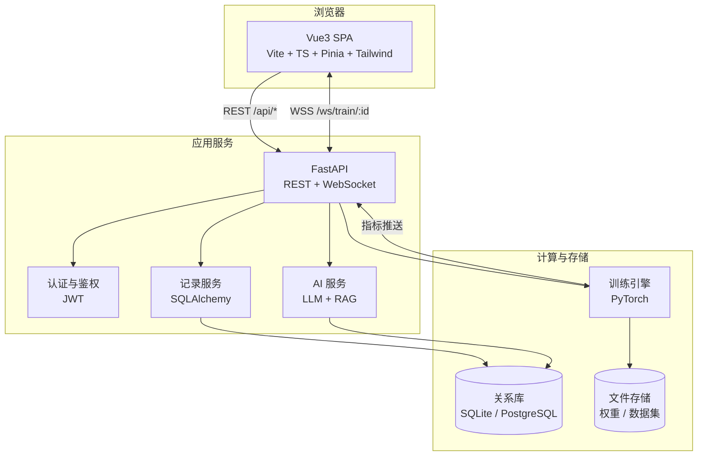
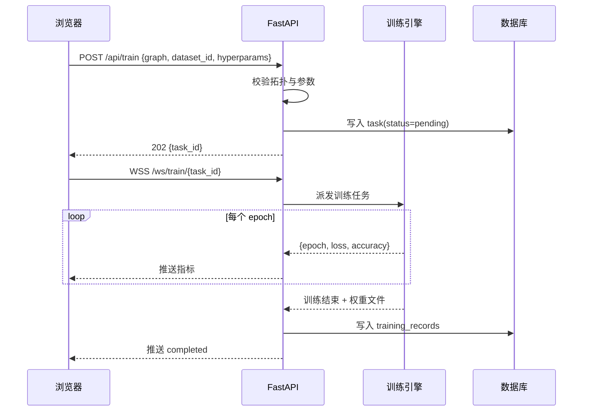
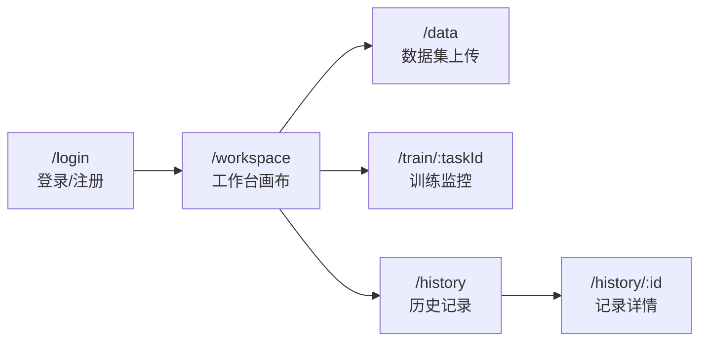
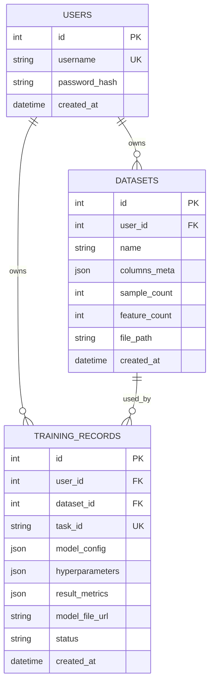

# DeepVision 设计文档

> **可视化深度学习实验平台** ｜ 版本 v4.0 ｜ 状态：草案
> 最后更新：2026-10-19

## 目录

1. [项目概述](#1-项目概述)
2. [产品范围](#2-产品范围)
3. [系统架构](#3-系统架构)
4. [视觉设计系统](#4-视觉设计系统)
5. [页面规格](#5-页面规格)
6. [数据模型](#6-数据模型)
7. [接口契约](#7-接口契约)
8. [阶段实施计划（开发任务书）](#8-阶段实施计划开发任务书)
9. [非功能需求](#9-非功能需求)
10. [风险与对策](#10-风险与对策)
11. [第二大阶段：3D 可视化与逐层指标](#11-第二大阶段3d-可视化与逐层指标)
12. [第三大阶段：独立教学实验室](#12-第三大阶段独立教学实验室-lab)
13. [教学价值论证与需求评估](#13-教学价值论证与需求评估)
14. [变更记录](#14-变更记录)

---

## 1. 项目概述

### 1.1 项目定位

DeepVision 是面向深度学习初学者与教学场景的**可视化神经网络实验平台**。用户无需编写代码，即可拖拽搭建网络、上传数据集、实时观察训练过程，并获得 LLM 助教的结构与超参数建议。

**一句话定位**：把「搭网络 + 看训练」从代码里搬到画布上。

### 1.2 目标用户与痛点

| 用户类型 | 核心诉求 | 现状痛点 |
| --- | --- | --- |
| 深度学习初学者 | 建立对网络结构与训练过程的直觉 | 概念抽象，无法感知数据在层间流动 |
| 高校学生 / 教师 | 课堂演示、对照实验 | 代码门槛高，现场演示效果差 |
| 算法工程师 | 快速验证网络结构 | 搭环境、写样板代码占用大量时间 |

### 1.3 核心价值主张

1. **可视化搭建** —— 拖拽即得网络拓扑，画布即数据源。
2. **过程可见** —— 训练实时动画，前向 / 反向传播可被「看见」。
3. **AI 协同** —— LLM 诊断结构合理性，输出可一键应用的修改建议。

### 1.4 名词约定

| 术语 | 含义 |
| --- | --- |
| 拓扑（Graph） | 画布中的节点与连线，序列化为 JSON |
| 节点（Node） | 网络的一层，含类型与参数 |
| 训练任务（Task） | 一次完整的训练执行，有独立 `task_id` |
| 训练记录（Record） | 训练任务结束后落库的持久化数据 |

### 1.5 三大阶段总览

项目按「能力边界」划分为三个大阶段，各自独立交付、互不阻塞：

| 阶段 | 定位 | 核心产物 | 文档位置 |
| --- | --- | --- | --- |
| **第一大阶段** | 生产工具：用户训练自己的数据 | 认证、2D 画布、CSV 数据集、训练引擎、AI 助教、训练记录 | §2–§10 |
| **第二大阶段** | 观察工具：让第一阶段的结构「看得见」 | 逐层统计（权重 / 梯度 / 激活）、顶栏视图切换、工作台 3D 只读视图 | §11 |
| **第三大阶段** | 教学工具：讲清楚「网络怎么学」 | 独立页面 `/lab`：滑块调参、3D 网络、实时仪表盘、AI 解析 | §12 |

三者的关系：

- **共享**：JWT 鉴权、前端设计 token、Three.js / ECharts 依赖。
- **数据隔离**：第一大阶段用用户上传的 CSV，第三大阶段用**内置双螺旋数据集**，无需上传。
- **记录隔离**：第一大阶段的训练写入 `training_records`；第三大阶段的训练目前**不落库**（见 §12.9）。

---

## 2. 产品范围

### 2.1 范围内（首版）

| 阶段 | 能力 |
| --- | --- |
| 一 | 用户认证、训练记录持久化 |
| 二 | 拖拽式拓扑搭建与可视化 |
| 三 | CSV 上传、解析与预处理 |
| 四 | 训练过程实时可视化 |
| 五 | LLM 助教与 Agent 调参建议 |

### 2.2 范围外（Non-goals）

明确不做，避免范围蔓延：

- **不做生产级分布式训练**：单机单进程，仅用于教学与验证。
- **不做完整 AutoML**：仅基于 LLM 给出建议，不做自动搜索。
- **不做特殊层类型**：节点均为全连接层（激活函数 ReLU / Sigmoid / Tanh），但拓扑支持任意前馈 DAG——分支与汇合均可训练，汇合按特征维 `concat` 合并。CNN / RNN 等特殊层类型列为后续版本。
- **不做图像 / 文本数据集**：首版仅支持 CSV 表格数据。
- **不做移动端 App**：仅提供响应式 Web，最小支持宽度 1280px。
- **不做模型部署与推理服务**：训练产物仅提供下载。

---

## 3. 系统架构

### 3.1 总体架构



### 3.2 技术选型

| 层 | 技术 | 版本 | 选型理由 |
| --- | --- | --- | --- |
| 前端框架 | Vue 3 + TypeScript | 3.4+ | Composition API，类型友好 |
| 构建 | Vite | 5+ | 冷启动与 HMR 快 |
| 状态 | Pinia | 2+ | 官方方案，模块化清晰 |
| 样式 | TailwindCSS | 3+ | Design Token 可直接映射为配置 |
| 图可视化 | 自研 SVG（v1） | — | 交互与样式完全可控，规避 G6 v5 的 API 变动风险 |
| 3D 渲染 | Three.js（第二大阶段引入） | — | 发光球体、权重驱动连线、激活呼吸动画 |
| 图表 | ECharts | 5+ | 双轴折线、实时数据更新成熟 |
| 请求 | Axios | 1+ | 拦截器便于统一鉴权与错误处理 |
| CSV 解析 | 自研解析器（`utils/csv.ts`） | — | 规避 npm 依赖安装问题；覆盖引号、转义、字段内换行、CRLF、BOM |
| 后端框架 | FastAPI | 0.110+ | 异步、自动生成 OpenAPI 文档 |
| ORM | SQLAlchemy | 2+ | 模型与迁移成熟 |
| 数据库 | SQLite（开发）/ PostgreSQL（生产） | — | 由 SQLAlchemy 屏蔽差异 |
| 认证 | PyJWT + argon2-cffi | — | 无状态认证 + 抗暴力哈希 |
| 训练 | PyTorch | 2+ | 动态图，便于逐 epoch 回调 |
| 实时通信 | WebSocket（FastAPI） | — | 训练指标低延迟推送 |
| LLM | 智谱 GLM / OpenAI 兼容接口 | — | 可替换，通过统一适配层 |

### 3.3 模块划分

| 模块 | 职责 | 边界约束 |
| --- | --- | --- |
| `frontend/` | 页面、交互、可视化 | 不直接访问数据库 |
| `backend/api/` | 路由、参数校验、鉴权 | 不包含训练逻辑 |
| `backend/services/` | 业务逻辑、记录读写 | 不处理 HTTP |
| `backend/ml/` | 网络构建、训练、指标回调 | 不感知用户与鉴权 |
| `backend/ai/` | LLM 调用、知识检索、输出过滤 | 可依赖 services，不被其反向依赖 |

### 3.4 训练数据流



---

## 4. 视觉设计系统

> 本章是「前端精致度」的唯一依据。所有页面实现必须引用本章 token，**禁止页面内硬编码色值与动效时长**。

### 4.1 设计原则

1. **深色为底，数据为光**：背景克制，让网络拓扑与指标曲线成为视觉焦点。
2. **层级靠明度，不靠阴影**：深色环境下用背景明度差与细边框建立层次，避免脏灰投影。
3. **动效有语义**：动画只表达「数据流向、状态变化、操作反馈」，不做无意义装饰。
4. **状态必须完整**：每个数据视图都要有 加载 / 空 / 错误 / 禁用 四态，不允许只做成功态。

### 4.2 色彩系统

```css
:root {
  /* 背景层级（由深到浅） */
  --bg-base:      #0A0E1A;  /* 页面底色 */
  --bg-surface:   #111827;  /* 卡片、面板 */
  --bg-elevated:  #1A2234;  /* 浮层、下拉、弹窗 */
  --bg-hover:     #1F2937;  /* 悬浮态 */

  /* 品牌色 */
  --brand-cyan:   #22D3EE;
  --brand-violet: #8B5CF6;
  --brand-gradient: linear-gradient(135deg, #22D3EE 0%, #8B5CF6 100%);

  /* 语义色 */
  --success: #34D399;
  --warning: #FBBF24;
  --danger:  #F87171;
  --info:    #60A5FA;

  /* 文本 */
  --text-primary:   #F1F5F9;
  --text-secondary: #94A3B8;
  --text-muted:     #64748B;
  --text-disabled:  #475569;

  /* 边框 */
  --border-subtle:  #1F2937;
  --border-default: #334155;
  --border-focus:   #22D3EE;

  /* 发光（深色主题以发光替代阴影） */
  --glow-cyan:   0 0 24px rgba(34, 211, 238, 0.25);
  --glow-violet: 0 0 24px rgba(139, 92, 246, 0.25);
}
```

**使用规则**

| 场景 | 规则 |
| --- | --- |
| 主操作按钮 | 青→紫渐变背景，文字用 `--bg-base` |
| 次操作按钮 | 透明底 + `--border-default` 边框，hover 边框转青 |
| 危险操作 | 仅图标与文字用 `--danger`，不填充红底 |
| 强调数值 | 使用 `--brand-cyan`，配合等宽字体 |
| 图表 | Loss 用青，Accuracy 用紫，双轴语义全程一致 |

### 4.3 字体与排版

| 用途 | 字体栈 |
| --- | --- |
| 正文 / 界面 | `Inter, "Noto Sans SC", "PingFang SC", "Microsoft YaHei", sans-serif` |
| 数值 / 代码 / 日志 | `"JetBrains Mono", "Fira Code", Consolas, monospace` |

**字号阶梯**（单位 px）

| Token | 字号 | 行高 | 用途 |
| --- | --- | --- | --- |
| `--text-xs` | 12 | 16 | 辅助说明、时间戳 |
| `--text-sm` | 14 | 20 | 表单、表格正文 |
| `--text-base` | 16 | 26 | 正文 |
| `--text-lg` | 18 | 28 | 卡片标题 |
| `--text-xl` | 24 | 32 | 区块标题 |
| `--text-2xl` | 30 | 38 | 页面标题 |
| `--text-3xl` | 38 | 46 | 落地页主标题 |

字重：常规 400、强调 500、标题 600、数字强调 700。

### 4.4 间距、圆角、层级

- **间距**：4 的倍数 —— `4 / 8 / 12 / 16 / 24 / 32 / 48 / 64`。页面左右留白 32，卡片内边距 24，表单项垂直间距 20。
- **圆角**：`sm 8 / md 12 / lg 16 / xl 24 / full 9999`。卡片用 `lg`，按钮用 `md`，输入框用 `sm`。
- **层级**：靠背景明度 + `1px` 边框区分；浮层额外叠加 8% 透明度青色外发光。

### 4.5 动效规范

```css
:root {
  --dur-fast:     120ms;  /* hover、按钮反馈 */
  --dur-base:     200ms;  /* 展开、切换 */
  --dur-emphasis: 320ms;  /* 面板滑入、图表更新 */
  --dur-scene:    480ms;  /* 路由转场 */

  --ease-standard: cubic-bezier(0.4, 0, 0.2, 1);
  --ease-enter:    cubic-bezier(0, 0, 0.2, 1);
  --ease-exit:     cubic-bezier(0.4, 0, 1, 1);
  --ease-spring:   cubic-bezier(0.34, 1.56, 0.64, 1);
}
```

| 动效 | 规格 |
| --- | --- |
| 按钮 hover | 背景提亮 + 上移 1px，`--dur-fast` |
| 按钮按下 | `scale(0.98)`，`--dur-fast` |
| 卡片 hover | 边框转 `--border-default` + 青色外发光，`--dur-base` |
| 面板滑入 | `translateX(16px) → 0` + 透明度 0→1，`--dur-emphasis` / `--ease-enter` |
| 路由切换 | `translateY(8px) → 0` + 透明度，`--dur-scene` |
| 指标数值变化 | 数字滚动过渡，`--dur-base` |
| 训练连线流光 | `stroke-dashoffset` 循环，周期 1.2s，前向与反向方向相反 |
| 错误抖动 | `translateX` ±4px 往复 3 次，共 240ms |

**降级**：`@media (prefers-reduced-motion: reduce)` 下关闭全部循环动画与位移，仅保留透明度变化。

### 4.6 组件规范

| 组件 | 变体 | 关键规格 |
| --- | --- | --- |
| Button | primary / secondary / ghost / danger | 高 36（md）、32（sm）、44（lg）；内边距 16；圆角 `md` |
| Input | 默认 / 聚焦 / 错误 / 禁用 | 高 40；聚焦边框转青 + 外发光；错误边框红 + 下方 12px 红字 |
| Card | 实心 / 玻璃 | 玻璃：`rgba(26,34,52,0.6)` + `backdrop-filter: blur(12px)` + 1px 边框 |
| Modal | 常规 / 危险确认 | 遮罩 `rgba(0,0,0,0.6)` + `blur(4px)`；内容 `--bg-elevated` |
| Toast | success / error / info | 右上堆叠，4s 自动消失，可手动关闭 |
| Skeleton | 文本 / 卡片 / 图表 | 微光扫过，周期 1.6s |
| Empty | 插画 + 说明 + 主操作 | 线框插画，主色 20% 透明度 |
| Table | 常规 / 可选中 | 表头粘性，行高 48，交替行用 `--bg-surface` |
| Badge | success / warning / danger / neutral | 高 20，圆角 `full`，字号 12 |
| Tooltip | 上 / 下 / 左 / 右 | 延迟 200ms，`--bg-elevated` + 细边框 |
| Drawer | 左 / 右 | 右抽屉宽 384，可拖拽调整至 640 |

### 4.7 响应式与无障碍

- **断点**：`1280`（最小支持）、`1440`、`1920`。小于 1280 时画布保留，左右面板折叠为抽屉。
- **对比度**：正文与背景 ≥ 4.5:1，大字号 ≥ 3:1。
- **键盘可达**：所有交互元素可 Tab 聚焦，聚焦环为 `2px` 青色 outline + 2px 偏移。
- **语义**：图标按钮必须有 `aria-label`；状态变化通过 `aria-live="polite"` 播报。

---

## 5. 页面规格

### 5.1 页面地图



### 5.2 登录 / 注册页 `/login`

**布局**：左右分栏 —— 左 60% 品牌区，右 40% 表单区；视口 < 1280 时仅保留表单区。

**品牌区**
- 背景：`--bg-base` 叠加径向渐变光晕（左上青、右下紫，透明度 12%）。
- 装饰：缓慢漂移的网络拓扑线框图（`<canvas>`，节点呼吸发光，周期 6s）。
- 文案：主标题 `--text-3xl`，副标题 `--text-base` / `--text-secondary`。
- 品牌区**不再放置 Logo 与版权行**，视觉焦点集中在标题与特性列表（v4.9 起）。

**表单区**
- 玻璃卡片：宽 360，内边距 32，圆角 `xl`。
- 字段：用户名、密码；注册模式增加确认密码。
- 浮动标签：聚焦时标签上移 12px 并缩至 12px。
- 密码强度条：4 段，颜色 红→黄→绿。
- 记住我、忘记密码（首版占位）。
- 主按钮通栏，提交中显示内联 spinner 并禁用。

**状态**

| 状态 | 表现 |
| --- | --- |
| 校验失败 | 字段下方红字，输入框红边 + 240ms 抖动 |
| 提交中 | 按钮禁用 + spinner，表单 `opacity: 0.7` |
| 服务端错误 | 顶部 Toast，保留已填内容 |
| 成功 | Toast 后 `--dur-scene` 淡出并跳转工作台 |

### 5.3 工作台画布 `/workspace`

**布局**

| 区域 | 尺寸 | 内容 |
| --- | --- | --- |
| 顶栏 | 64px | 视图模式切换（权重 / 梯度 / 激活）、3D 视图切换、校验拓扑、数据集、教学实验室、开始训练、用户与退出；**左侧不放 Logo / 项目名 / 阶段徽章 / 保存状态**（v4.9 起） |
| 左侧节点库 | 240px | 输入层 / 隐藏层 / 输出层卡片，可拖拽 |
| 画布 | 自适应 | 点阵网格、节点、连线、小地图、缩放控件 |
| 右侧属性面板 | 320px | 选中节点的参数表单，默认折叠 |

**画布**
- 背景：`radial-gradient` 点阵，点径 1px，间距 24px，透明度 0.15。
- 缩放：滚轮 25%–400%，`Ctrl + 滚轮` 精细缩放；左下显示百分比，可点击重置为 100%。
- 平移：空格 + 拖拽，或中键拖拽。
- 小地图：右下角 160×120，视口框可拖动。
- 对齐：拖动节点时显示 8px 吸附网格与对齐辅助线。

**节点**
- 形态：圆角矩形 120×72，圆角 `lg`。
- 类型配色：输入层青边、隐藏层紫边、输出层绿边；填充统一 `--bg-surface`。
- 内容：层名（14px / 500），关键参数（12px / `--text-secondary`，如 `128 · ReLU`）。
- 悬浮：边框转对应品牌色 + 外发光，上移 2px。
- 选中：2px 品牌色描边 + 外发光。
- 双击或 Enter：右侧面板滑入该节点表单。

**连线**
- 贝塞尔曲线，默认 `--border-default`，线宽 1.5。
- 悬停 / 选中：转品牌色渐变 + 发光。
- 禁止成环：非法连线变红并抖动 240ms，同时 Toast 提示。
- 禁止自连与重复连线。

**空状态**
- 画布中央线框插画 + 文案「从左侧拖入节点开始搭建」。
- 提供「三层 MLP 快速模板」按钮，一键生成 输入 → 隐藏 → 输出。

**持久化与快捷键**
- 自动保存：变更后 2s 防抖存本地草稿；顶栏显示「已保存 12:03:44」。
- `Delete` 删除选中节点；`Ctrl+Z` / `Ctrl+Y` 撤销重做，保留 50 步；`Ctrl+S` 立即保存。

**交互反馈**

| 操作 | 反馈 |
| --- | --- |
| 从节点库拖出 | 跟随指针的幽灵节点，60% 透明度 |
| 落在画布 | 吸附网格，`--ease-spring` 轻微弹入 |
| 连线成功 | 连线快速流光一次 |
| 参数修改 | 节点内容即时更新，数值变化带动画 |

### 5.4 数据集上传页 `/data`

**布局**：单列最大宽 960 居中；三段式 —— 上传区、预览与列选择、统计与确认。

**上传区**
- 虚线边框 2px，圆角 `lg`，高 200。
- 悬浮 / 拖入：边框转青 + 青紫渐变光晕，图标上浮 4px。
- 支持点击选择，限制 `.csv`，≤ 50MB。

**预览与列选择**
- 表格：前 10 行，表头粘性，行高 40，溢出横向滚动。
- 列类型徽标：数值 / 类别 / 日期 自动推断，可手动纠正。
- 特征列多选、目标列单选，分别用复选框与单选圆点。
- 选中列在表头加浅青底强调。

**缺失值处理**
- 含空值单元格黄色底 + 角标。
- 全局选项：均值填充 / 中位数填充 / 众数填充 / 删除该行。
- 选项变化后实时显示「处理后样本数：1832 / 2000」。

**统计与确认**
- 四张统计卡：样本数、特征数、缺失率、目标分布（迷你柱状图）。
- 确认后提交至后端，成功 Toast 并跳转工作台。

**状态**

| 状态 | 表现 |
| --- | --- |
| 解析中 | 进度条 + 百分比，禁用确认 |
| 文件非法 | 上传区红边 + 明确原因（非 CSV / 编码错误 / 空文件 / 超限） |
| 列未选完整 | 确认按钮禁用 + Tooltip 说明原因 |
| 后端失败 | Toast + 保留本地预览，可重试 |

### 5.5 训练监控页 `/train/:taskId`

**布局**

| 区域 | 内容 |
| --- | --- |
| 顶部状态条 | 任务状态徽章、Epoch 总进度环、耗时、停止按钮 |
| 主图区（左 2/3） | Loss / Accuracy 双轴折线图 |
| 拓扑动画区（右 1/3） | 实时网络拓扑，前向与反向传播流光 |
| 底部日志 | 等宽字体日志流，自动滚动到底 |

**指标图**
- ECharts 双 Y 轴：左轴 Loss 青色，右轴 Accuracy 紫色；平滑曲线，不显示数据点。
- 数据更新动画 300ms；保留最近 200 个 epoch，超出滚动。
- 图例可点击隐藏对应系列。

**拓扑动画**
- 前向传播：流光自输入向输出，周期与 batch 时长同步，青色。
- 反向传播：流光反向，色相偏移至紫红，表示梯度回传。
- 节点亮度随该层梯度范数变化（透明度 0.4–1.0）。

**状态与容错**

| 状态 | 表现 |
| --- | --- |
| 连接中 | 骨架屏 + 「正在建立训练通道」 |
| 训练中 | 顶栏呼吸光点，进度环实时更新 |
| 已完成 | 徽章转绿，弹出「保存记录成功」并给出详情入口 |
| 中断 | 红色徽章 + 原因，提供「重新训练」 |
| 断线 | 自动重连，指数退避 1s→2s→4s→8s→16s，最多 5 次；失败后提示手动重连并保留已收数据 |

### 5.6 历史记录页 `/history`

**布局**：顶部筛选栏 + 卡片网格（1440 下 3 列）。

**筛选栏**
- 时间范围、数据集、状态（成功 / 失败 / 中断）、搜索框、排序（默认时间倒序）。

**记录卡**
- 上部：网络迷你拓扑缩略图（SVG 静态绘制）。
- 中部：记录名（数据集名 + 时间）、指标徽章（Loss / Accuracy）、耗时。
- 下部：查看详情、重新训练、删除（二次确认）。

**状态**

| 状态 | 表现 |
| --- | --- |
| 加载 | 6 张骨架卡 |
| 空 | 中央插画 + 「还没有训练记录」+「去搭建第一个网络」 |
| 错误 | 错误提示 + 重试按钮 |
| 删除中 | 卡片淡出 + 高度收起，`--dur-base` |

### 5.7 记录详情页 `/history/:id`

- 只读拓扑视图（复用画布渲染，禁用交互）。
- 超参数与数据集信息以定义列表呈现。
- 指标曲线为静态图，可导出 CSV / 图片。
- 模型权重下载按钮（文件缺失时禁用并说明原因）。

### 5.8 AI 助教抽屉

- 入口：任意页面右下角悬浮按钮（渐变圆 56px），点击滑入右抽屉。
- 抽屉宽 384，可拖拽至 640；`--dur-emphasis` 滑入。
- 消息气泡：用户右侧紫渐变，AI 左侧玻璃卡；AI 内容支持流式打字机输出。
- 快捷问题：预置 4 条（如「这个网络合理吗？」「学习率该设多少？」）。
- 诊断结果卡：问题列表 + 「一键应用建议」，点击后直接在画布高亮并修改对应节点，同时 Toast 说明改动。
- 引用来源以脚注展示，可折叠。

---

## 6. 数据模型

### 6.1 ER 关系



### 6.2 表定义

**users**

| 字段 | 类型 | 约束 | 说明 |
| --- | --- | --- | --- |
| id | bigint | PK, 自增 | 主键 |
| username | varchar(64) | UK, not null | 登录名 |
| password_hash | varchar(255) | not null | argon2 哈希 |
| created_at | datetime | not null | UTC |

**datasets**

| 字段 | 类型 | 约束 | 说明 |
| --- | --- | --- | --- |
| id | bigint | PK | — |
| user_id | bigint | FK users, index | 归属用户 |
| name | varchar(255) | not null | 文件名或自定义名 |
| columns_meta | json | not null | `[{name, dtype, missing}]` |
| target_column | varchar(255) | null | 目标列名 |
| missing_strategy | varchar(16) | not null | mean / median / mode / drop |
| stats | json | not null | 特征与目标的均值、方差，目标分布 |
| sample_count | int | not null | 处理后样本数 |
| feature_count | int | not null | 特征列数 |
| file_path | varchar(512) | not null | 存储路径 |
| created_at | datetime | not null | — |

**training_records**

| 字段 | 类型 | 约束 | 说明 |
| --- | --- | --- | --- |
| id | bigint | PK | — |
| user_id | bigint | FK users, index | 归属用户 |
| dataset_id | bigint | FK datasets, index | 数据集 |
| task_id | varchar(64) | UK | 训练任务标识 |
| model_config | json | not null | 拓扑结构 |
| hyperparameters | json | not null | 学习率、batch、epochs |
| result_metrics | json | not null | loss、accuracy、耗时 |
| model_file_url | varchar(512) | null | 权重路径 |
| status | varchar(16) | not null | pending / running / success / failed / interrupted |
| created_at | datetime | not null, index | — |

### 6.3 核心 JSON 结构

**model_config（网络拓扑）**

```json
{
  "version": 1,
  "nodes": [
    { "id": "n1", "type": "input",  "params": { "features": 8 } },
    { "id": "n2", "type": "hidden", "params": { "units": 128, "activation": "relu" } },
    { "id": "n3", "type": "output", "params": { "units": 2, "task": "classification" } }
  ],
  "edges": [
    { "source": "n1", "target": "n2" },
    { "source": "n2", "target": "n3" }
  ]
}
```

**hyperparameters**

```json
{ "epochs": 50, "batch_size": 32, "learning_rate": 0.001, "optimizer": "adam" }
```

**result_metrics**

```json
{
  "final_loss": 0.184,
  "final_accuracy": 0.943,
  "duration_sec": 126.4,
  "history": [ { "epoch": 1, "loss": 0.92, "accuracy": 0.61 } ]
}
```

---

## 7. 接口契约

### 7.1 通用约定

- 基础路径 `/api`，数据格式 `application/json`。
- 鉴权：`Authorization: Bearer <jwt>`；未认证返回 `401`，越权返回 `403`。
- 统一错误体：`{ "code": "STRING", "message": "中文说明", "detail": {} }`。
- 分页参数 `page`、`page_size`，响应含 `{ items, total, page, page_size }`。

### 7.2 REST 接口

| 方法 | 路径 | 说明 | 认证 |
| --- | --- | --- | --- |
| POST | `/api/auth/register` | 注册 | 否 |
| POST | `/api/auth/login` | 登录，返回 JWT | 否 |
| GET | `/api/auth/me` | 当前用户信息 | 是 |
| POST | `/api/datasets` | 上传并解析 CSV | 是 |
| GET | `/api/datasets` | 数据集列表 | 是 |
| GET | `/api/datasets/{id}` | 数据集详情与统计 | 是 |
| POST | `/api/train` | 创建训练任务 | 是 |
| POST | `/api/train/{task_id}/stop` | 停止训练 | 是 |
| GET | `/api/records` | 训练记录列表 | 是 |
| GET | `/api/records/{id}` | 记录详情 | 是 |
| DELETE | `/api/records/{id}` | 删除记录 | 是 |
| POST | `/api/graph/validate` | 校验拓扑结构，返回错误/告警与执行计划 | 是 |
| POST | `/api/ai/chat` | 助教问答 | 是 |
| POST | `/api/ai/diagnose` | 拓扑诊断 | 是 |

**示例：`POST /api/auth/login`**

请求

```json
{ "username": "alice", "password": "Str0ng!pass" }
```

响应 `200`

```json
{
  "access_token": "eyJhbGciOi...",
  "token_type": "bearer",
  "expires_in": 7200,
  "user": { "id": 1, "username": "alice" }
}
```

**示例：`POST /api/ai/diagnose`**

请求

```json
{
  "graph": { "version": 1, "nodes": [], "edges": [] },
  "dataset_meta": { "features": 8, "task": "classification" }
}
```

响应 `200`

```json
{
  "score": 72,
  "issues": [
    { "node_id": "n2", "severity": "warning", "message": "隐藏层神经元数(4)少于输入特征数(8)" }
  ],
  "suggestions": [
    { "node_id": "n2", "field": "units", "from": 4, "to": 32, "reason": "提升表示能力" }
  ]
}
```

### 7.3 WebSocket 协议

**连接**：`wss://<host>/ws/train/{task_id}?token=<jwt>`

**服务端 → 客户端消息**

| type | 载荷 | 说明 |
| --- | --- | --- |
| `started` | `{ task_id, total_epochs }` | 训练开始 |
| `epoch` | `{ epoch, loss, accuracy, elapsed_ms }` | 每轮指标 |
| `completed` | `{ record_id, final_loss, final_accuracy }` | 训练完成 |
| `failed` | `{ reason }` | 训练失败 |
| `stopped` | `{ epoch }` | 用户中断 |

**心跳**：客户端每 15s 发送 `{"type":"ping"}`，服务端回 `{"type":"pong"}`；连续 2 次无响应触发重连。

---

## 8. 阶段实施计划（开发任务书）

> 每份任务书为自包含的开发单元：明确交付物、接口契约与可验证的验收标准。完成一个阶段即形成一次独立提交。

### 阶段一：基础架构与用户系统

**目标**：打通「注册 → 登录 → 鉴权 → 记录读写」链路，并落地设计系统基础设施。

**交付物**

| 端 | 内容 |
| --- | --- |
| 后端 | 项目骨架与配置、数据库会话、`users` / `training_records` 模型、Alembic 迁移、注册与登录接口、JWT 签发与校验依赖、argon2 密码哈希、记录 CRUD |
| 前端 | Vite + Vue3 + TS + Tailwind + Pinia 脚手架、路由与守卫、Axios 鉴权拦截器（401 自动登出）、登录 / 注册页、基础组件 Button / Input / Card / Toast / Skeleton |

**接口契约**：`/api/auth/register`、`/api/auth/login`、`/api/auth/me`、`/api/records`

**验收标准**

- [ ] 数据库中的密码为 argon2 哈希，不存在明文。
- [ ] 登录返回 JWT，携带该 token 可成功访问 `/api/records`。
- [ ] 无 token 或 token 过期访问受保护接口返回 `401`。
- [ ] 前端未登录访问 `/workspace` 被重定向至 `/login`。
- [ ] 登录页在 1440×900 下无横向滚动；字段校验与服务端错误两种错误态均可复现。
- [ ] 所有请求失败均有 Toast 提示，不出现静默失败。

**依赖**：无

### 阶段二：神经网络结构搭建与可视化

**目标**：实现可用的拖拽式拓扑编辑器，输出规范化的 `model_config`。

**交付物**

| 端 | 内容 |
| --- | --- |
| 前端 | 画布组件（自研 SVG，见 §3.2）、节点库、属性面板、graph store、拖拽与连线、成环校验、撤销重做、小地图、缩放平移、空状态与快速模板 |
| 后端 | 可选 `POST /api/graph/validate`：拓扑结构服务端二次校验 |

**输出契约**：第 6.3 节 `model_config`

**实现决策（2026-10-18）**

- 图可视化采用**自研 SVG**，不引入 G6：交互与样式完全可控，且规避 G6 v5 的 API 变动风险。
- 画布支持任意前馈 DAG：**分支与汇合均可训练**，汇合节点按特征维 `concat` 合并。校验接口会生成执行计划（拓扑序 + 每个节点的前驱），阶段四据此物化模型。原来的「仅支持链式结构」限制已取消。

**验收标准**

- [ ] 三类节点均可从左侧拖入画布。
- [ ] 可建立有向连线；成环、自连、重复连线被拒绝并给出可见提示。
- [ ] 双击节点可编辑参数，修改即时反映在节点显示上。
- [ ] 缩放范围 25%–400%，支持平移与一键重置。
- [ ] 100 个节点下拖动节点帧率不低于 50fps。
- [ ] 撤销 / 重做支持 50 步。
- [ ] 导出的 JSON 通过 `model_config` schema 校验。
- [ ] 空画布展示引导与「三层 MLP 快速模板」，点击可生成默认结构。

**依赖**：阶段一

### 阶段三：CSV 数据集上传与预处理

**目标**：完成从文件到可训练数据的完整通路。

**交付物**

| 端 | 内容 |
| --- | --- |
| 前端 | 拖拽上传组件、自研 CSV 解析器（见下方实现决策）、前 10 行预览表、列角色选择、类型推断、缺失值处理、统计卡 |
| 后端 | `POST /api/datasets` 接收与解析（Pandas）、统计计算、落库、文件存储；`GET /api/datasets`、`GET /api/datasets/{id}` |

**实现决策（2026-10-18）**

- 前端 CSV 解析改为**自研解析器**（`frontend/src/utils/csv.ts`）：本机 npm 依赖树损坏导致 PapaParse 无法安装；解析器已覆盖引号、转义双引号、字段内换行、CRLF 与 BOM。依赖树修复后可直接换回 PapaParse。
- 上传的原始 CSV 落在 `storage/datasets/{user_id}/`，该目录已加入 `.gitignore`。
- 缺失值策略在前后端各实现一次：前端用于实时估算「处理后样本数」，后端（Pandas）为最终口径，二者语义一致且有测试对齐。

**验收标准**

- [ ] 上传 10MB CSV 在 3s 内完成预览渲染。
- [ ] 自动推断数值 / 类别类型，并允许手动纠正。
- [ ] 切换缺失值处理后，「处理后样本数」实时更新且与后端结果一致。
- [ ] 非 CSV、编码错误、空文件、超过 50MB 四类异常均有明确提示。
- [ ] 后端返回的样本数、特征数、均值、方差与 Pandas 直接计算一致。

**依赖**：阶段一

### 阶段四：训练过程与实时结果可视化

**目标**：训练可执行、指标可实时观测、结果可持久化。

**交付物**

| 端 | 内容 |
| --- | --- |
| 后端 | 训练任务派发与状态机、按执行计划（拓扑序 + 前驱 + `concat` 汇合）物化 PyTorch 模块、逐 epoch 回调、WebSocket 推送、结束写入 `training_records`、权重落盘 |
| 前端 | 训练监控页、ECharts 双轴实时曲线、拓扑前向 / 反向流光、日志流、断线重连、停止训练 |

**接口契约**：`POST /api/train`、`WS /ws/train/{task_id}`

**实现决策（2026-10-18）**

- 训练在**后台线程**中执行，事件通过 `asyncio.Queue` 广播给 WebSocket；任务内保留完整历史，**断线重连时先回放历史再续推**，因此不会丢数据。
- 训练任务在 WebSocket 建立后才启动（`POST /api/train` 只创建 pending 任务），避免"开训瞬间的指标无人接收"。
- 预处理管线：数值特征 z-score 标准化（统计量仅取训练集）、类别特征独热编码（类别数上限 50）、按 8:2 随机划分训练 / 验证集。
- 分类任务标签编码为 0..k-1，输出层单元数必须等于类别数；回归任务输出 1 个单元，损失用 MSE。
- **多输入**：按拓扑序取所有输入层，按各自声明的 `features` **依次切分特征维**（例如两个输入层声明 2 和 1，则取第 0–1 列与第 2 列）；声明的特征数之和必须等于预处理后的实际维度，否则训练直接失败并报出各层的分配明细。
- **多输出**：各输出层单元数必须一致（分类时还须等于类别数），前向时对多个输出**按逐元素均值合并**，等价于多头平均集成；因此校验接口会拒绝单元数不一致的多输出拓扑。
- 权重保存为 `storage/models/{user_id}/{task_id}.pt`。
- 前端拓扑流光为**视觉表现**（按固定节奏播放），不做逐 batch 的数据驱动；方向固定为前向。

**验收标准**

- [ ] 点击开始训练后，每 epoch 指标在 200ms 内到达前端并渲染。
- [ ] 训练结束自动生成 `training_records`，状态为 `success`。
- [ ] 训练失败时记录状态为 `failed` 且保存失败原因。
- [ ] 断开网络后 5 次指数退避内自动重连，已收数据不丢失。
- [ ] 拓扑流光方向与传播方向一致（前向正向、反向逆向）。
- [ ] 训练可被用户中止，状态变为 `interrupted`。
- [ ] 含分支 / 汇合的拓扑可正常训练，汇合节点按 `concat` 拼接。
- [x] 多输入按特征数切分（2+1=3 可训练），特征数之和与维度不符时报错
- [x] 多输出按均值合并，单元数不一致时校验拒绝

**依赖**：阶段二、阶段三

### 阶段五：大模型集成与 Agent 工作流

**目标**：为平台引入 AI 助教与结构诊断能力。

**交付物**

| 端 | 内容 |
| --- | --- |
| 后端 | LLM 适配层（GLM / OpenAI 兼容）、RAG 知识库与检索、`/api/ai/chat` 流式输出、`/api/ai/diagnose` 结构化诊断、输入输出过滤与限流 |
| 前端 | AI 助教抽屉、流式消息渲染、快捷问题、诊断结果卡、「一键应用建议」修改画布 |

**接口契约**：`POST /api/ai/chat`、`POST /api/ai/diagnose`（响应结构见 7.2）

**实现决策（2026-10-18）**

- **双模式**：配置 `llm_provider` + `llm_api_key` 时调用 OpenAI 兼容的流式接口（GLM 等改 `llm_base_url` 即可）；未配置或调用失败时**自动降级为内置知识库**，功能可用且可测试。问答响应首条事件 `meta.mode` 标明当前模式。
- **RAG 用关键词检索**而非向量库：知识库仅 14 条，关键词命中打分足够，省去 embedding 依赖。
- **诊断用规则引擎**，不依赖 LLM：保证结构化输出稳定。建议只针对**已有节点的参数**（`features` / `units` / `activation` / `task`），因此前端「一键应用」可靠且可撤销；结构性问题（如缺隐藏层）只作为 issue 提示。
- **限流为进程内滑动窗口**（20 次/分钟/用户），重启即重置，单机部署够用；多实例部署需换成 Redis。
- 输入敏感词直接拒绝（400 `INPUT_REJECTED`），输出做脱敏替换。

**验收标准**

- [ ] 提问「什么是梯度消失」可获得解释，并附至少 1 条知识来源。
- [ ] 诊断接口返回严格符合约定 schema 的 JSON（`score` / `issues` / `suggestions`）。
- [ ] 点击「一键应用建议」后画布节点参数被修改，且在撤销栈中可回退。
- [ ] LLM 不可用时返回友好降级提示，不阻塞其他功能。
- [ ] 单用户问答频率受限流约束（如 20 次 / 分钟）。
- [ ] 明显的敏感输入被过滤，且不返回原始有害内容。

**依赖**：阶段二

---

## 9. 非功能需求

### 9.1 性能

| 指标 | 目标 |
| --- | --- |
| 首屏 LCP | < 2.5s（4G 模拟） |
| 路由切换 | < 300ms |
| 画布交互 | 100 节点下 ≥ 50fps |
| 训练指标延迟 | < 200ms |
| 接口 P95 | < 500ms（不含训练与 LLM） |

### 9.2 安全

- 密码使用 argon2id 哈希，参数按 OWASP 推荐配置。
- JWT 有效期 2h，密钥来自环境变量，禁止硬编码与提交进仓库。
- 所有记录类接口强制校验资源归属，防止 ID 越权。
- 上传文件校验扩展名、MIME、大小与可解析性；存储路径与用户输入解耦。
- LLM 输入输出双向过滤；不将未转义的用户内容直接拼入指令。
- 生产环境启用 HTTPS 与 CORS 白名单。

### 9.3 兼容性

- Chrome / Edge 最近两个大版本。
- 最小视口 1280×720，推荐 1440×900。
- 深色主题为默认，浅色切换列入后续版本。

### 9.4 可观测性

- 结构化日志（含 `request_id`），训练任务记录完整生命周期事件。
- 错误统一捕获并上报；前端错误边界展示可重试的降级界面。

---

## 10. 风险与对策

| 风险 | 影响 | 对策 |
| --- | --- | --- |
| LLM 响应慢或成本高 | 交互卡顿、费用不可控 | 流式输出、结果缓存、按用户限流、超时降级 |
| 训练占用资源 | 阻塞其他请求 | 限制并发任务数、设最大 epoch 与超时、训练放入线程池 |
| 恶意或超大 CSV | 内存溢出 | 大小与行数硬限制、流式解析、超限即拒绝 |
| 图库性能瓶颈 | 大图卡顿 | 节点数上限提示、连线简化、必要时切 Canvas 渲染 |
| WebSocket 断线 | 指标丢失 | 心跳 + 指数退避重连 + 重连后补拉历史指标 |
| 历史记录膨胀 | 查询变慢 | 分页 + 索引 + 归档策略 |

---

## 11. 第二大阶段：3D 可视化与逐层指标

> 第二大阶段**不新增产品线**，而是在第一大阶段之上补两层能力：
> ① 训练时产出**逐层统计**（数据基础）；② 用**顶栏视图切换**与**3D 只读拓扑**把这些数字变成可感知的视觉。
> 面向教学的滑块调参与独立页面属于第三大阶段（§12）。

### 11.1 目标与范围

| 项 | 内容 |
| --- | --- |
| 目标 | 让用户在**不离开工作台**的前提下，看见每一层的权重规模、梯度强度与激活水平 |
| 非目标 | 不做 3D 编辑、不做滑块批量调参、不做教学页（均属第三大阶段） |
| 前置依赖 | 第一阶段的拓扑、训练引擎与 WebSocket |
| 交付物 | 逐层统计、顶栏三态切换、工作台 3D 只读视图 |

### 11.2 分工与复用

| 能力 | 复用方式 |
| --- | --- |
| 认证与鉴权 | 直接复用，不新增账号体系 |
| 数据集与预处理 | 直接复用（`POST /api/datasets`、标准化与独热编码） |
| 训练引擎与 WebSocket | 复用；**新增**逐层统计随 epoch 推送 |
| 画布与状态管理 | 2D 画布继续负责**编辑**；3D 只作为**只读视觉层** |
| AI 助教 | 本阶段不改；带上下文的诊断在第三阶段（§12.6） |

**设计文档第二版的四模块，实际落点如下**：

| 第二版模块 | 落点 |
| --- | --- |
| 模块一 3D 拓扑引擎 | 本阶段 §11.5（工作台只读视图）+ §12.2（实验室） |
| 模块二 左侧控制面板 | 第三大阶段 §12.2（工作台仍用属性面板逐节点编辑） |
| 模块三 底部仪表盘 | 曲线与指标卡沿用第一阶段训练页；直方图与决策边界在 §12.2 |
| 模块四 AI Agent | 第三大阶段 §12.6 |

### 11.3 数据基础：逐层统计

**指标定义**

| 指标 | 定义 | 用途 |
| --- | --- | --- |
| `weight_norm` | 该层 `Linear` 权重绝对值之和 | 权重视图的连线粗细 |
| `grad_norm` | 该层梯度绝对值之和 | 梯度视图 |
| `activation_mean` | 该层输出激活的绝对值均值 | 激活视图与呼吸动画幅度 |

**采集方式**

1. `DagNet.forward_intermediates(x)` 按拓扑序返回每个节点的输出张量；
2. 每个 epoch 训练结束后，取前 32 条验证样本前向一次，同时读取各层 `parameter.grad`；
3. 组装进 `epoch` 事件：

```json
{
  "type": "epoch",
  "epoch": 3,
  "train_loss": 0.41,
  "val_loss": 0.38,
  "accuracy": 0.86,
  "grad_norm": 1.273,
  "layer_stats": [
    {
      "node_id": "n2",
      "weight_norm": 3.21,
      "grad_norm": 0.84,
      "activation_mean": 0.42
    }
  ]
}
```

4. 最后一轮的 `layer_stats` 写入 `training_records.result_metrics.layer_stats`，供下次打开工作台时复用。

**约定**：没有参数的节点（输入层）不出现在 `layer_stats` 中。

### 11.4 顶栏视图模式切换

**位置**：工作台顶栏中部。

**渲染规则**

| 模式 | 连线粗细 | 节点发光 |
| --- | --- | --- |
| 权重 | 目标层 `weight_norm` 归一化 | 该层 `weight_norm` |
| 梯度 | 目标层 `grad_norm` 归一化 | 该层 `grad_norm` |
| 激活 | **源节点** `activation_mean` 归一化 | 该节点 `activation_mean` |

- 归一化：`value / max(所有节点该指标)`，截断到 `[0, 1]`。
- 线宽：`1.2 + 3 × ratio`；节点发光半径：`8 + 18 × ratio` px。
- 归属规则：权重与梯度属于**目标层**的线性变换；激活属于**源节点**的输出。

**退化行为**：未加载到逐层统计时（从未训练），画布保持中性样式，控件 tooltip 提示「完成一次训练后可查看逐层数据」，不报错。

**状态**：`graph` store 新增 `viewMode` / `layerStats` / `layerStatsLoaded`；工作台挂载时读取最近一次训练记录的 `layer_stats`；`viewMode` 写入 `localStorage('dv_view_mode')`，刷新后保持上次选择。

### 11.5 3D 只读拓扑视图

**入口**：顶栏「3D 视图 / 2D 编辑」按钮，与视图模式控件并排；开关状态写入 `localStorage('dv_view_3d')`。

**布局**：**优先沿用 2D 画布的手工坐标**——取节点的 `x / y` 映射到世界坐标的 `X / -Y`（SVG 的 y 轴向下，需翻转），Z 轴按拓扑层级（Kahn 最长路径）错开 `120` 单位；只有当所有节点几乎重合（横纵跨度均 ≤ 150）时才回退为「按层环形排布」。

**视觉**

| 元素 | 实现 |
| --- | --- |
| 节点 | `SphereGeometry` + `MeshStandardMaterial`（emissive） |
| 颜色 | 输入 `#7dd3fc` / 隐藏 `#22d3ee` / 输出 `#a78bfa` |
| 半径 | `9 + min(units, 64) × 0.45` |
| 连线 | `TubeGeometry`，半径 `0.9 + 3 × ratio`，颜色 `#94a3b8`、不透明度 `0.5 + 0.45 × ratio` |
| 光晕 | `Sprite` + `AdditiveBlending`，缩放为节点半径的 4.2 倍，基础不透明度 0.32 |
| 呼吸 | 仅激活模式：`opacity = base × (0.55 + 0.45 sin(2.2t + phase))` |

**交互**：OrbitControls（左键旋转 / 滚轮缩放 / 右键平移，带阻尼）；射线拾取节点与连线，悬浮气泡显示三项数值。

**辅助能力**

| 能力 | 说明 |
| --- | --- |
| 帧率显示 | 右上角实时显示 `xx fps`（每 500ms 统计一次），用于验证 100 节点内是否 ≥ 30fps |
| 亮度调节 | 右上角滑杆 0.6–2.5，映射到 `toneMappingExposure`，适配不同显示器 |
| 导出图片 | 开启 `preserveDrawingBuffer`，点击「导出图片」把当前画面保存为 PNG |

**性能**：`defineAsyncComponent` 按需加载（独立 chunk ≈ 571KB）；卸载时释放 renderer / geometry / material，并断开 ResizeObserver 与动画帧。

**降级**：WebGL 初始化失败时显示提示条，2D 画布不受影响。

### 11.6 交互与状态

| 操作 | 行为 |
| --- | --- |
| 切换视图模式 | 立即重算连线与节点样式，不重新布局；选择持久化 |
| 切到 3D | 2D 画布卸载，3D 按当前拓扑重建；偏好持久化 |
| 3D 下点节点库 | 自动切回 2D 再添加，避免操作落空 |
| 切回 2D | 草稿与撤销栈不受影响（状态都在 store） |
| 刷新页面 | 视图模式与 2D / 3D 选择保持不变；逐层统计重新从最近一次记录加载 |

### 11.7 技术实现与文件清单

| 文件 | 职责 |
| --- | --- |
| `backend/app/services/dag_model.py` | `forward_intermediates()` |
| `backend/app/services/training.py` | `_collect_layer_stats()`、epoch 事件、`result_metrics.layer_stats` |
| `frontend/src/stores/graph.ts` | `viewMode`（含持久化）/ `layerStats` / `setLayerStats` |
| `frontend/src/views/WorkspaceView.vue` | 顶栏切换、3D 偏好持久化、加载最近一次统计 |
| `frontend/src/components/canvas/NetworkCanvas.vue` | 按模式计算连线强度 |
| `frontend/src/components/canvas/GraphNode.vue` | 节点发光强度 |
| `frontend/src/components/threed/Network3DView.vue` | 3D 场景、2D 坐标映射、悬浮拾取、呼吸动画、FPS、导出图片 |
| `frontend/src/views/TrainView.vue` | 逐层权重范数曲线 |

### 11.8 差异与决策

| 设计文档第二版原文 | 本项目决策 |
| --- | --- |
| Three.js / ECharts-GL | 采用 Three.js 0.186，**只读视觉层** |
| ECharts 5 | 沿用已装的 ECharts 6.1 |
| MySQL | 不引入，继续 SQLite / PostgreSQL（§3.2） |
| 左侧参数面板 | **迁入第三大阶段** `/lab`（§12.2），工作台仍用属性面板逐节点编辑 |
| 底部仪表盘 | 曲线与指标卡留在第一阶段训练页；直方图与决策边界迁入 `/lab` |
| AI Agent 上下文 | 迁入 `/lab` 的助教面板（§12.6） |
| WebSocket 暂停 | 第一阶段保持「开始 / 停止」；暂停在 `/lab` 实现 |
| 3D 编辑 | 2D 负责编辑，3D 只读，避免两套编辑逻辑 |

### 11.9 验收状态与已知限制

- [x] 每个 epoch 推送 `layer_stats`，并写入 `result_metrics.layer_stats`
- [x] 顶栏三态切换，2D 画布与 3D 视图同步响应
- [x] 3D 可旋转 / 缩放 / 平移，悬浮显示三项数值
- [x] three.js 按需加载，不影响 2D 首屏
- [x] 3D 布局优先沿用 2D 手工坐标，重合时回退环形布局
- [x] 视图模式与 2D / 3D 偏好持久化（`localStorage`）
- [x] 逐层权重范数曲线（训练页，按层分色）
- [x] 当前 3D 视图可导出为 PNG
- [x] 右上角实时 FPS 显示，可自行验证 100 节点内是否 ≥ 30fps
- [x] 多输入 / 多输出拓扑在 3D 视图中正常分层渲染（与训练语义一致）
- [ ] 连线未做避让，节点密集时可能穿插
- [ ] 浏览器中的 WebGL 渲染效果未人工验证（本次无可用浏览器连接）

**已知限制**

- 3D 布局优先参考 2D 坐标；两者不一致时以 2D 为准，重排需回到 2D 拖动。
- 逐层统计只保存最后一轮，无法回放中间 epoch 的权重分布（训练页曲线仅覆盖本次会话）。

### 11.10 后续路线

| 优先级 | 内容 | 状态 |
| --- | --- | --- |
| P1 | 用 `InstancedMesh` 承载节点，提升大图帧率 | 暂缓：当前节点规模远小于 100，且需要保留逐节点 emissive，收益有限 |
| P2 | 3D 布局参考 2D 坐标 | **已完成** |
| P3 | 视图模式与 2D / 3D 偏好持久化 | **已完成** |
| P4 | 逐层指标历史曲线（权重范数随 epoch 变化） | **已完成**（训练页） |
| P5 | 导出当前 3D 视图为图片 | **已完成** |

---

## 12. 第三大阶段：独立教学实验室 `/lab`

> 第三大阶段是一个**独立的教学产品**，不是第一阶段工作台里的视图开关。
> 它用内置数据、可拖动的参数与实时可视化，讲清楚「网络是怎么学的」；与第一阶段共享账号体系，但**不共享数据与训练记录**。

### 12.1 目标与定位

| 维度 | 第一大阶段 | 第二大阶段 | 第三大阶段 |
| --- | --- | --- | --- |
| 使用者 | 需要训练自有数据的用户 | 需要观察结构的用户 | 学习者、课堂演示 |
| 数据 | 用户上传 CSV | 复用第一阶段的训练结果 | **内置双螺旋数据集**，零配置 |
| 结构来源 | 2D 画布自由搭建 | 只读 3D 预览 | 左侧滑块实时改结构 |
| 核心目标 | 产出可用的训练记录 | 让权重 / 梯度 / 激活可感知 | 直观理解训练过程与决策边界 |
| 入口 | `/workspace` | `/workspace` 内切换 | `/lab` |

### 12.2 页面布局

| 区域 | 内容 |
| --- | --- |
| 顶栏 | 标题、导航（**前向/反向传播 · 注意力 3D · 降维投影**，点击打开观察弹窗）、引擎与状态、返回工作台 |
| 左栏 | **输入神经元数**、**输出类别数**、每层神经元滑块、增删隐藏层、激活函数、初始化、优化器、学习率 / 批大小 / 轮数 / L2 / Dropout 滑块；构建 / 开始 / 暂停 / 恢复 / 停止 / 重置视角 |
| 中区 | 3D 网络（按层排布、全连接、层名标签跟随投影）；下方仪表盘 |
| 下仪表盘 | 5 张 KPI 卡（轮次 / 训练 loss / 验证 loss / 准确率 / 梯度范数）+ loss 曲线 + 权重分布直方图 + 决策边界与数据分布 |
| 右栏 | 模型引擎选择、4 个快捷问题、自定义提问、流式解析输出、实时指标（数据集 / 结构 / 参数量 / 优化器 / 学习率 / 会话状态） |

### 12.3 后端接口

| 接口 | 说明 |
| --- | --- |
| `POST /api/lab/train` | 创建实验室训练任务，返回 `task_id` 与参数量 |
| `POST /api/lab/{task_id}/pause` \| `resume` \| `stop` | 训练控制（新增暂停 / 恢复语义） |
| `WS /ws/lab/{task_id}` | 推送 `started` / `epoch` / `weights` / `boundary` / `completed` / `paused` / `resumed` / `stopped` |
| `GET /api/lab/{task_id}/inspect?index=` | 单样本前向 + 反向：逐层激活 / 梯度、输入注意力、预测概率 |
| `GET /api/lab/{task_id}/projection?layer=&method=pca\|tsne` | 指定层降维：PCA（最多 600 点，带解释度）或 t-SNE（最多 300 点） |
| `GET /api/lab/{task_id}/attention` | 逐 epoch 的输入特征注意力序列 |

### 12.4 数据与指标

- 数据集按配置**自动生成**：输入维度 `input_units`（1–8，超过 2 维的部分为零均值噪声）、类别数 `output_units`（2–6）；2 类为双螺旋，3 类以上为环形分布；约 2000 点，1400 训练 / 600 验证，无需上传。
- 每个 epoch 推送 train/val loss、验证准确率、梯度范数，以及**该 epoch 的输入注意力**（验证集前 32 条的 `|∂loss/∂x × x|` 均值）。
- 每 3 个 epoch（以及首尾）推送**权重分布直方图**（20 个分箱）与**决策边界**（48×48 概率网格 + 320 个数据点）。
- 训练结束（含中止）保留模型与数据，供 `inspect` / `projection` / `attention` 使用；并把结果写入 `training_records`（`source = lab`、`dataset_id = null`）。

### 12.5 验收状态

- [x] 左侧滑块改变层数 / 神经元数后，3D 网络与参数量实时更新
- [x] **输入神经元数（1–8）与输出类别数（2–6）可调**，数据集、3D 层宽、参数量与决策边界同步变化
- [x] 开始 / 暂停 / 恢复 / 停止可用，暂停期间不产生新的 epoch
- [x] 曲线、直方图、决策边界随训练更新
- [x] 参数恒等：`[8, 8]` 结构参数量为 114，与参考界面一致
- [x] 前向 / 反向传播单步：`inspect` 返回逐层激活与梯度，弹窗可逐层前后切换
- [x] 注意力：按 `|∂loss/∂x × x|` 计算输入特征贡献，条形图展示，并在 3D 中放大/提亮对应的输入节点
- [x] 降维投影：指定层的激活可经 **PCA** 或 **t-SNE** 降到二维，Canvas 散点展示（PCA 附带解释度）
- [x] 注意力随时间变化：逐 epoch 记录输入注意力，弹窗内折线图展示各特征贡献走势
- [x] 弹窗内直接导出图片：`html2canvas` 按需加载，导出当前标签页内容为 PNG
- [x] AI 面板的 Markdown 渲染（`marked` + `DOMPurify`）
- [x] 模型引擎切换生效（auto / llm / offline）
- [x] 实验室训练记录落库，`source = lab`

### 12.6 交互细节

| 交互 | 行为 |
| --- | --- |
| 左栏滑块 | `input[type=range]` 双向绑定；改变层数或神经元后，`layers` 变化驱动 3D 重建，参数量按 `Σ(prev × units + units)` 即时重算 |
| 构建 / 重建模型 | 清空历史与图表、重置相机、参数量回显 |
| 开始训练 | 创建任务后建立 WebSocket；训练中禁用「开始」，启用「暂停 / 停止」 |
| 暂停 / 恢复 | 后端用 `threading.Event` 挂起训练循环，暂停期间不产生新 epoch；「恢复」继续 |
| 重置视角 | 仅重置相机，不影响训练 |
| 3D 操作 | 左键拖拽旋转、滚轮缩放、右键平移（OrbitControls） |
| 图表更新 | ECharts 用增量 `setOption`，不销毁实例，避免闪烁 |
| 决策边界 | Canvas 2D 逐格填充概率色，叠加 320 个数据点；随训练周期性重绘 |
| 观察弹窗 | 顶栏三项导航打开同一弹窗的三个标签页；传播页可逐层「上一步 / 下一步」，注意力页显示输入贡献，投影页可切换层并重新投影 |
| 注意力联动 | 弹窗算出注意力后回传主页面，3D 输入层节点按贡献放大并提亮 |
| 传播动画 | 训练中每条连线有光点自左向右流动，各层按 `layer × 0.22s` 依次点亮并放大 18%；左下角显示「● 前向传播中」；暂停 / 停止后立即回到静止呼吸状态 |

### 12.7 技术实现

| 层 | 实现 |
| --- | --- |
| 数据集 | `numpy` 生成双螺旋，2000 点（1400 / 600），固定随机种子保证可复现 |
| 模型 | `torch.nn.Sequential`；初始化支持 He / Xavier / 均匀 |
| 训练 | 后台线程 + `threading.Event`（暂停 / 停止）；Adam 或 SGD，L2 通过 `weight_decay` 实现 |
| 推送 | `asyncio.Queue` 广播；`weights` 与 `boundary` 每 3 个 epoch（含首尾）推送一次 |
| 3D | Three.js 0.186 + OrbitControls；`SphereGeometry` 节点、`LineSegments` 全连接、HTML 标签跟随投影 |
| 图表 | ECharts 6（曲线、直方图）+ Canvas 2D（决策边界） |
| 传播观察 | 逐层 `retain_grad()` 取梯度；输入注意力 = `\|grad × input\|`；输出概率由 `softmax` 给出 |
| 降维投影 | 取指定层激活 → 中心化 → `numpy.linalg.svd` → 前两个主成分坐标 |
| Markdown | 前端 `marked` 渲染 + `DOMPurify` 消毒后 `v-html` |
| 记录落库 | 写入 `training_records`，`source='lab'`，`dataset_id=null`，`result_metrics` 含末 200 个 epoch |
| 大模型接入 | OpenAI 兼容 `/chat/completions`；TLS 默认使用**系统证书库**（代理注入根证书时 certifi 不可信），可用 `LLM_VERIFY_SSL=false` 兜底 |

### 12.8 与第一 / 二阶段的边界

- **共享**：JWT 鉴权、前端设计 token、Three.js / ECharts 依赖。
- **独立**：数据（内置螺旋 vs 用户 CSV）、模型（配置驱动 vs 画布拓扑）。
- **记录打通（已实现）**：`training_records` 新增 `source` 字段（`platform` / `lab`），实验室训练也写入历史，但 `dataset_id` 为空；第一阶段用 `source=platform` 过滤即可互不干扰。

### 12.9 后续路线

| 优先级 | 内容 | 状态 |
| --- | --- | --- |
| P1 | 前向 / 反向传播单步演示 | **已完成**（弹窗逐层切换） |
| P2 | 注意力 3D | **已完成**（`|grad × x|` 条形图 + 3D 输入节点高亮；非 Transformer 自注意力） |
| P3 | 降维投影（PCA） | **已完成**（`numpy` SVD） |
| P4 | AI 面板 Markdown 渲染与引擎切换生效 | **已完成**（`marked` + `DOMPurify`，`mode` 参数） |
| P5 | 实验室训练记录落库 | **已完成**（`source='lab'`） |
| 后续 | 注意力热力图的逐层版本、t-SNE 的困惑度可调、导出矢量图 | 待排期 |

---

## 13. 教学价值论证与需求评估

> 本章回答三个问题：**为什么做**（痛点）、**做了什么**（方案）、**有没有用**（效果）。
> 前三章描述「是什么」，本章描述「值不值」。

### 13.1 痛点：传统深度学习实验教学的真实困难

以下现象来自教学场景的常见观察，标注「待量化」的条目目前**没有本项目实测数据**，将作为试测指标（见 §13.3）。

| 编号 | 痛点 | 具体表现 | 影响 |
| --- | --- | --- | --- |
| T1 | 环境门槛高 | CUDA / PyTorch 版本不匹配、依赖冲突，首次跑通往往占用一节课以上 | 学生精力消耗在配置而非概念 |
| T2 | 结构不可见 | 只能看到一条 loss 曲线，层宽、连接、激活状态全在「想象」中 | 对「网络在算什么」缺乏直觉 |
| T3 | 调参靠猜 | 改学习率、层宽后要等训练结束才知道效果，缺乏即时反馈 | 试错成本高，容易放弃 |
| T4 | 过程不可回放 | 训练结束只剩最终指标，中间 epoch 的状态无法复查 | 无法回答「什么时候开始过拟合」 |
| T5 | 结果不可复现 | 随机种子、数据版本、代码状态未记录，换台机器就复现不了 | 实验结论不可信 |
| T6 | 报错不可读 | `shape mismatch`、维度不匹配等报错对初学者不友好 | 卡在错误信息上，而非概念上 |
| T7 | 评价单一 | 以最终准确率论成败，忽略「为什么」 | 学生学会调参，没学会判断 |

### 13.2 方案映射：每个痛点对应什么能力

| 痛点 | 平台能力 | 落点 |
| --- | --- | --- |
| T1 | 浏览器即用，内置数据集，零环境配置 | `/lab` |
| T2 | 2D 拓扑画布 + 3D 发光网络 + 逐层权重/梯度/激活 | `/workspace`、`/lab` |
| T3 | 实时曲线 + 逐层统计 + 结构诊断 + 自动调参（规划） | `/train`、`/lab` |
| T4 | epoch 级事件流 + 张量分布演化 + 快照回溯（规划） | `/lab` |
| T5 | 训练记录 + 配置快照 + 一键重跑（规划） | `/history`（规划） |
| T6 | 结构校验前置 + 统一错误体 `{code, message, detail}` | 全局 |
| T7 | 引导任务 + 检查点问答 + 对比实验 + 错误示范（规划） | `/lab` |

### 13.3 效果：与传统实验教学的对比

> 下表的「传统方式」是常见教学场景的**区间估计**，不是本项目实测；「本平台」是**设计目标**。
> 真实数值需通过小样本试测获得（建议 n≈20，同一任务前后测），**本文档不预先填写未测数据**。

| 指标 | 传统方式（估计） | 本平台（设计目标） | 验证方式 |
| --- | --- | --- | --- |
| 首次跑通时间 | 0.5–2 天 | ≤ 10 分钟 | 记录从打开页面到首次完成训练 |
| 结构理解 | 依赖想象 / 板书 | 可旋转、可逐层查看 | 概念测验（结构题 10 道） |
| 调参反馈 | 训练结束后看日志 | 实时曲线 + 即时提示 | 任务完成率与尝试次数 |
| 过程观察 | 只有末态指标 | 逐 epoch + 快照回放 | 能否定位「过拟合起始 epoch」 |
| 复现一致性 | 手工记录，常丢失 | 记录 + 配置快照 | 同配置重跑，指标差异 ≤ 1% |
| 学习动机 | 以作业驱动为主 | 任务化 + 即时反馈 | 自评量表 / 访谈 |

**论证方式**：不主张「平台更好」这一结论本身，而是提供**可验证的指标定义与测量流程**，把结论交给试测。

### 13.4 六项需求的可行性评估与完整版范围

> 2026-10-21 评审沟通确认：第（2）（4）（6）项**按完整版纳入范围**，但需分里程碑交付，不与现有表格训练引擎一次性替换。

| # | 需求 | 结论 | 完整版范围 | 关键技术与风险 | 批次 |
| --- | --- | --- | --- | --- | --- |
| 1 | 训练动态监控与异常诊断、多实验曲线对齐 | 合理，优先做 | 规则引擎识别过拟合 / 欠拟合 / 学习率过大过小；多记录按 epoch 或归一化时间对齐 | 阈值需按数据调；对齐需统一 x 轴语义 | **P0 已完成** |
| 2 | 计算图动静结合 | 合理，但要单独立项 | 张量 shape / dtype / 参数量 / 内存估算 / 逐层耗时热力图；**生成等效 PyTorch 代码并维护行号映射**，点击节点跳到代码行；剪枝、量化、算子融合（前后对比） | codegen 与执行图必须同源，否则跳转会错行；算子融合的信息来自 `torch.compile` / FX，**可得性有限，只能覆盖兼容子图**，需在文档中明示 | P2 进行中（形状 / dtype / 参数 / 耗时已完成） |
| 3 | 张量分布演化、快照回溯、高维交互与可解释 | 合理 | 每 N 个 epoch 存 `state_dict` 快照；任意快照回放决策边界 / 投影 / 传播；张量分位数与直方图演化；Integrated Gradients 归因 | 快照体积与频率需权衡；小模型可每 5 epoch 存一次 | P2 进行中（权重分布演化已完成） |
| 4 | 全流程闭环：可复现、可追溯、协作 | 前两项易做，协作需改造数据模型 | 配置快照 + 种子 + 依赖版本 + 一键重跑；**项目空间 + 成员角色（owner/editor/viewer）+ 评论 + 分享链接 + 审计日志** | 资源归属需从 `user_id` 迁移到 `project_id`，涉及全部表与权限中间件，属于架构级改造 | **P0 复现/追溯已完成**；协作 P3 |
| 5 | 突出教学过程而非演示 | 最重要，当前最弱 | 教学目标、引导任务卡、检查点问答、同数据双配置对比实验、错误示范（如 lr=0.5 发散）、教师端课堂同步 | 需要课程内容设计，工作量大且依赖教学经验输入 | **P1** |
| 6 | 大模型辅助、自动调参、多模态统一 | 前两项可做，多模态需扩引擎 | LLM 解释曲线 / 生成实验报告；随机搜索 + 早停的自动调参；**图像与文本数据管线 + CNN / Embedding / Attention 节点 + 统一数据抽象** | 训练引擎需从「表格 DAG」泛化为「多模态计算图」，新增节点类型与编码器；这是最大的工程项，建议独立里程碑 | P2（自动调参）/ P3（多模态） |

**完整版的共同前提**：上述能力都要求**训练引擎保留中间态**（张量、耗时、快照、代码映射）。当前引擎只保留逐层统计，因此 P2 起的工作需要先做一次「训练运行时」改造，这是排期的关键依赖。

### 13.5 路线图

| 批次 | 内容 | 依赖 | 状态 |
| --- | --- | --- | --- |
| **P0** | 诊断规则引擎、多实验曲线对齐、配置快照与一键重跑、本章论证 | 现有 `training_records.history` | **已完成** |
| **P1** | 教学闭环：教学目标、引导任务、检查点、对比实验、错误示范 | P0 的对比能力 | **已完成（首版）** |
| **P2** | 训练运行时改造（张量/耗时/代码映射）、计算图增强、自动调参、张量演化 | 引擎中间态 | **进行中**：运行时剖析、权重分布演化、等效代码、自动调参、剪枝/量化已完成；算子融合待做 |
| **P3** | 快照回放、项目空间与协作、多模态统一 | P2 运行时 | **进行中**：快照回放已完成；协作 / 多模态待做 |

### 13.6 P0 实现说明

**后端**

| 文件 | 职责 |
| --- | --- |
| `app/services/curve_diagnosis.py` | 规则引擎：发散、过拟合、学习率过大 / 过小、欠拟合 |
| `app/api/v1/records.py` | 新增 `GET /records/{id}/diagnosis`、`GET /records/compare?ids=`、`POST /records/{id}/rerun` |
| `app/services/training.py` | 训练前 `torch.manual_seed(seed)`，并把 `seed` 写入 `result_metrics` |

**诊断阈值**（教学场景启发式，写死在服务里便于解释）

| 常量 | 值 | 含义 |
| --- | --- | --- |
| `MIN_POINTS` | 6 | 少于 6 个 epoch 不诊断 |
| `HIGH_LOSS` | 0.5 | 教学数据集上「还没学会」的参考线 |
| `FLAT_RATIO` | 5% | 整体改进低于此值视为平台期 |
| `OSCILLATION_AMPLITUDE` | 15% | loss 波动幅度超过此值视为震荡 |

**前端**：新增 `/history` 页面（工作台「历史记录」入口）

- 多选 **2–4 条**记录 → 对比曲线（按 epoch 或按训练进度对齐，train 实线 / val 虚线）
- 单条「诊断」→ 弹窗展示问题、证据与建议
- 单条「重跑」→ 按原结构与超参创建新任务并跳转训练页

**限制**

- 规则是启发式，阈值针对教学数据集；换成其它量纲（如回归 MSE）需要重新标定。
- 实验室记录（`source='lab'`）没有关联数据集，**不支持重跑**，接口返回 `RERUN_UNAVAILABLE`。

### 13.7 P1 实现说明（教学闭环首版）

**目标**：把「可玩的演示器」变成「有目标、有检验的实验课」。

| 要素 | 实现 |
| --- | --- |
| 教学目标 | 每个任务卡写清「你将理解什么」与操作提示 |
| 引导任务 | 顶栏「实验任务」打开任务列表，点「应用」一键填充左侧参数（结构、学习率、轮次等） |
| 达标判定 | 训练完成后自动调用 `GET /api/lab/{task_id}/diagnosis`：目标类任务看验证准确率，错误示范类任务看是否出现预期异常 |
| 检查点 | 每个任务附 1–2 道单选题，选完立即给出解释（对/错都解释） |
| 错误示范 | 两个内置反面案例：学习率 `0.5`（震荡/发散）、隐藏层 `[1]`（欠拟合） |
| 对比实验 | 任务结果弹窗底部「再跑一组对比」：保存本组指标后清空曲线，改参数再训练，结果弹窗并排显示两组准确率与 loss |

**内置任务**

| 任务 | 类型 | 预设 | 达标条件 |
| --- | --- | --- | --- |
| 把双螺旋分开 | 目标 | 2→8→8→2，lr 0.05，60 轮 | 验证准确率 ≥ 0.9 |
| 学习率过大 | 错误示范 | lr 0.5，40 轮 | 诊断命中 `diverged` / `lr_too_high` |
| 隐藏层太窄 | 错误示范 | 隐藏层 `[1]`，60 轮 | 诊断命中 `underfitting` |

**限制**

- 检查点题目写在 `frontend/src/data/teachingTasks.ts`，属于静态内容，新增课程需要改代码（后续可配置化）。
- 对比实验目前只对比**汇总指标**（准确率 / loss）；曲线级对比请到 `/history` 多选记录。
- 达标阈值是教学设定，不应理解为模型能力的客观结论。

### 13.8 P2 首版：训练运行时剖析与张量演化

**目标**：让引擎在执行时保留「每层张量长什么样、占多少参数、花了多少时间、权重分布怎么变」，为计算图增强与快照回放打底。

| 能力 | 实现 |
| --- | --- |
| 逐层形状 / dtype | `DagNet.profile(x)` 按拓扑序执行一次前向，记录每节点 `in_dim → out_dim`、`dtype`、`param_count` |
| 逐层耗时 | 对每个 `Linear` 单独计时（`perf_counter`），得到 `time_ms`；输入节点记 0 |
| 内存估算 | 每节点给出 `weight_bytes`（参数 × 4）与 `activation_bytes`（单批 × 输出维度 × 4 字节） |
| 事件推送 | 训练开始后推送一次 `graph_profile` 事件，断线重连会随生命周期事件回放 |
| 持久化 | 写入 `result_metrics.graph_profile`，打开历史记录时仍可查看 |
| 张量演化 | `layer_stats` 新增 `weight_mean` / `weight_std`；训练页的逐层曲线支持**范数 / 标准差**切换 |
| 等效代码 | `codegen.generate_code()` 由同一份拓扑生成 PyTorch 代码，并维护「节点 → 定义行 / 前向行」映射 |

**前端**

- 训练页新增「计算图剖析」表格：节点、类型、输入→输出、dtype、参数、内存、耗时、占比条，表尾给出合计
- **拓扑热力叠加**：右侧「网络拓扑」的节点按耗时占比着色（越深越慢），悬停显示形状 / 耗时 / 权重与激活内存
- 点击表格任意一行打开「等效代码」查看器，高亮该节点的定义行与前向计算行
- 逐层曲线新增切换：`‖W‖₁`（范数）与 `σ(W)`（标准差），用于观察权重分布如何收紧或发散

**接口**

| 接口 | 用途 |
| --- | --- |
| `GET /api/train/{task_id}/code` | 按任务配置生成代码（训练中即可查看） |
| `GET /api/records/{record_id}/code` | 按历史记录配置生成代码 |
| `POST /api/lab/tune` | 启动自动调参（随机搜索 + 早停） |
| `GET /api/lab/tune/{tune_id}` | 轮询调参进度与试验结果 |

**自动调参**

- 搜索空间：学习率 `1e-3 – 1e-1`（对数均匀）、隐藏层 5 种结构、激活 `relu/tanh`、`l2 ∈ {0, 1e-4, 1e-3}`、`dropout ∈ {0, 0.1}`、`batch ∈ {16, 32, 64}`
- 每次试验最多 N 轮，连续 4 轮验证准确率没有提升即**早停**，记录 `epochs_run` 与 `early_stopped`
- 后台线程执行，前端每 800ms 轮询；结果表格标出最佳试验，「应用最佳参数」一键回填左侧参数

**剪枝 / 量化**

| 方案 | 做法 |
| --- | --- |
| magnitude 剪枝 | 按权重绝对值剪掉最小的 `sparsity` 比例（30% / 50% / 70%），永久置零 |
| 动态量化 | `quantize_dynamic(..., dtype=qint8)`，Linear 权重转 int8，激活运行时量化 |

实测示例（2→16→16→2，30 轮，验证子集 20%）：

| 方案 | 准确率 | 非零参数 | 权重字节 | 序列化体积 |
| --- | --- | --- | --- | --- |
| 原始 float32 | 0.927 | 354 | 1416 B | 4117 B |
| 剪枝 30% | 0.920 | 257 | 1416 B（稠密不变） | 4117 B |
| 剪枝 70% | 0.655 | 131 | 1416 B（稠密不变） | 4117 B |
| int8 量化 | 0.925 | — | 344 B（4.12×） | 5119 B |

两个教学结论：

1. **剪枝不等于省空间**：置零后仍是稠密存储，体积不变；要省空间需要稀疏格式（估算 `sparse_bytes = 非零数 × 8`）。
2. **极小模型的量化序列化体积可能反而变大**：int8 权重虽小，但 scale / zero_point 等元数据占比高。因此报告「理论权重字节」与「序列化体积」两个口径。

**限制**

- 生成代码是**只读展示**，与训练执行共用同一份配置，但 codegen 不是引擎的真相源；两者若出现偏差以 `DagNet` 为准。
- 耗时是单次前向的粗略测量（CPU），不是 `torch.profiler` 的算子级数据，也不含反向传播。
- 内存是按公式估算：权重 `参数 × 4`，激活 `单批(32) × 输出维度 × 4`，**不是真实峰值显存**，也不含优化器状态与中间缓冲。
- 剪枝 / 量化只针对教学 MLP；`torch.ao.quantization` 已被标记为废弃（2.10 移除），后续需迁移到 torchao。
- 算子融合仍待后续批次。

### 13.9 P3 首版：快照回放

**目标**：训练结束后能回到任意时刻，看「当时的模型把边界画成什么样」，而不是只记住最终准确率。

| 能力 | 实现 |
| --- | --- |
| 快照采集 | 每 `epochs / 20` 轮（至少 1 轮）保存一次 `state_dict`，最多约 21 份；附带该时刻的验证准确率与 loss |
| 列表接口 | `GET /api/lab/{task_id}/snapshots` |
| 回放接口 | `GET /api/lab/{task_id}/snapshot?epoch=`：用快照参数重建模型，重算准确率 / loss 与决策边界 |
| 前端 | 「快照回放」弹窗：进度条、上一个 / 下一个、**播放**（700ms/帧）、画布重绘决策边界与样本点 |

**实测**（2→16→16→2，40 轮）：21 个快照，第 1 轮准确率 0.567 → 第 40 轮 0.773；单次回放约 24ms（48×48 网格 + 320 个样本点）。

**可解释性：Integrated Gradients**

| 能力 | 实现 |
| --- | --- |
| 算法 | `lab.integrated_gradients()`：基线取全零，沿「基线 → 样本」直线积分梯度（默认 32 步），归因 = `(x - 基线) × 平均梯度` |
| 接口 | `GET /api/lab/{task_id}/attribution?index=`：返回预测类别、置信度、真实标签、每个特征的贡献值 |
| 前端 | 观察弹窗新增「归因」标签：按特征画横向条形图，正值青色、负值红色，可输入样本下标重新计算 |

**限制**

- 快照是**参数副本**，不是训练录像；两次快照之间的变化看不到。
- 只保留在内存中，服务重启后丢失。
- 回放只重建决策边界与指标，不重建当时的前向 / 反向单步数据。
- 归因基线固定为全零（不是背景分布），且只解释**当前预测类别**；高维输入时标签为 `f0…fn`，没有语义名称。

### 13.10 P3 首版：图像实验线（表格 + 小图像两条线）

**定位**：平台支持两条**独立**的实验线——表格分类（可编辑 DAG）与图像分类（固定小 CNN）。两条线共用训练、监控与记录体系，但**不做跨模态融合**。

| 能力 | 实现 |
| --- | --- |
| 数据集 | 内置合成「圆形 / 方形」灰度图（默认 16×16，位置抖动 + 噪声），保存为 `.npz`，完全离线 |
| 数据集接口 | `POST /api/datasets/image?样本数&边长`、`GET /api/datasets/{id}/preview` |
| 训练 | `POST /api/train/image`：固定网络 `Conv(1→8,3×3) → ReLU → MaxPool → Conv(8→16,3×3) → ReLU → MaxPool → Flatten → Linear` |
| 事件 | 与表格线一致（`started` / `epoch` / `completed`），训练页无需区分 |
| 前端 | `/images` 页面：生成数据集、样本预览（画布逐像素绘制）、训练参数、一键训练 |

**实测**：400 张 16×16、3 轮，准确率 0.66（轮数少，符合预期；20 轮可到 0.9+）。

**边界（明确不做）**

- 不做「图像 + 表格」联合输入，不做多模态融合。
- 不做图像增强、迁移学习、预训练权重、文本 / 音频。
- 图像线**不可编辑拓扑**，卷积结构与通道数是固定的。
- 数据库新增 `datasets.kind`（`tabular` / `image`），由迁移 `8c4d2e1f7b90` 添加。

### 13.11 如何证明「有效」

1. **定义指标**：按 §13.3 的六项指标，先写清楚测量口径。
2. **小样本试测**：同一批学生、同一任务，对比「传统方式」与「平台方式」的前后测。
3. **可复现**：试测用的配置、种子、数据版本全部随记录保存，任何人可重跑。
4. **如实报告**：差异不显著也照实写，不用「显著提升」这类无依据表述。

---

## 14. 变更记录

| 版本 | 日期 | 说明 |
| --- | --- | --- |
| v1.0 | 2026-10-17 | 五阶段功能概述与 Prompt 模板 |
| v2.0 | 2026-10-17 | 重构为正式设计文档：补全架构、设计系统、页面规格、数据模型、接口契约、阶段任务书与非功能需求；Prompt 模板重构为可验收的开发任务书 |
| v3.0 | 2026-10-18 | 纳入第二大阶段：新增 §11（3D 可视化引擎、控制面板与状态管理、实时监控仪表盘、AI Agent），补充复用关系、差异决策、实施批次；P1（顶栏视图切换 + 逐层统计）已完成 |
| v3.1 | 2026-10-19 | 修正第二大阶段定位：从「工作台内的 3D 视图开关」改为**独立教学实验室页面 `/lab`**；新增 §11.8（页面布局、`/api/lab/*` 与 `/ws/lab/*`、双螺旋数据集、验收状态）；P2–P4 完成，P5 部分完成 |
| v4.0 | 2026-10-19 | **将教学实验室独立为第三大阶段**：新增 §12（目标与定位、页面布局、后端接口、数据与指标、验收状态、交互细节、技术实现、阶段边界、后续路线）；§11 收敛为第二大阶段（逐层统计 + 顶栏视图 + 工作台 3D）；新增 §1.5 三大阶段总览；目录与变更记录同步 |
| v4.1 | 2026-10-19 | **完善第二大阶段**：§11 由「第二版四模块清单」重写为完整规格，新增 11.1 目标与范围、11.2 模块落点映射、11.3 逐层统计（指标定义 / 采集方式 / 事件结构）、11.4 视图切换渲染规则与退化行为、11.5 3D 视图布局与视觉参数、11.6 交互与状态、11.7 文件清单、11.9 验收与已知限制、11.10 后续路线；§11.8 差异表按新分工重写 |
| v4.2 | 2026-10-19 | **完成第二大阶段剩余任务**：3D 布局改为优先沿用 2D 手工坐标（重合时回退）、视图模式与 2D/3D 偏好持久化、3D 视图新增实时 FPS 与 PNG 导出、训练页新增逐层权重范数曲线；§11.9 验收与 §11.10 路线同步更新（P2–P5 完成，P1 暂缓并说明理由） |
| v4.3 | 2026-10-19 | **支持多输入 / 多输出**：取消「恰好一个输入层 / 输出层」的限制；多输入按各层声明的特征数依次切分（之和须等于实际维度），多输出要求单元数一致并按逐元素均值合并；同步放宽可达性 / 死分支校验、更新前端预检与提示；§8 补充语义说明与验收项，§11.9 增加多输入多输出渲染验收 |
| v4.4 | 2026-10-19 | **完成第三大阶段**：新增 `GET /api/lab/{task_id}/inspect`（逐层激活 / 梯度 + 输入注意力）与 `/projection`（PCA 二维投影）；前端新增观察弹窗（传播单步 / 注意力条形图 + 3D 输入节点高亮 / 降维散点）；AI 面板支持 Markdown 渲染与 auto/llm/offline 引擎切换；`training_records` 新增 `source` 字段并落库实验室训练；§12.2–§12.9 与验收项同步 |
| v4.5 | 2026-10-19 | **接通 DeepSeek**：`llm.py` 的 TLS 校验从 certifi 改为**系统证书库**（修复代理注入根证书导致的 `CERTIFICATE_VERIFY_FAILED`），新增 `LLM_VERIFY_SSL` 开关与失败日志；测试新增 autouse 夹具屏蔽本地 `.env`，保证测试始终走内置知识库；§12.7 与 README 补充接入说明 |
| v4.6 | 2026-10-19 | **补齐第三大阶段三项**：新增 t-SNE 降维（numpy 精确实现，300 点约 0.2s）、逐 epoch 输入注意力曲线（`GET /attention`）、观察弹窗内导出 PNG（`html2canvas` 按需加载）；§12.3 / §12.4 / §12.5 / §12.9 同步 |
| v4.7 | 2026-10-20 | **教学实验室传播动画**：训练中连线出现自左向右流动的脉冲光点，各层按 `layer × 0.22s` 依次点亮放大，暂停 / 停止即止；纯前端实现，不增加后端推送；§12.6 补充交互说明 |
| v4.8 | 2026-10-20 | **输入 / 输出可调**：新增 `input_units`（1–8）与 `output_units`（2–6）配置；数据集按维度与类别数自动生成（>2 维补噪声、≥3 类为环形分布）；决策边界改为「每格预测类别 + 置信度」，前端按类别调色；§12.2 / §12.4 / §12.5 同步 |
| v4.9 | 2026-10-20 | **界面清理与图表排版**：登录页移除左上 Logo 与左下版权行、品牌区改为垂直居中；工作台顶栏移除 Logo / 项目名 / 阶段徽章 / 草稿状态；教学实验室移除「第二大阶段」徽章；仪表盘曲线去掉轴名、加高图例区、x 轴自动抽稀、准确率改虚线，直方图标签 45° 且柱顶圆角；§5.2 / §5.3 / §11.4 同步 |
| v5.0 | 2026-10-21 | **新增 §13 教学价值论证与需求评估**：痛点 T1–T7、方案映射、效果对比（设计目标 + 试测口径，不预填未测数据）、六项需求的可行性评估与**完整版范围**、路线图 P0–P3、有效性验证方法；变更记录顺延为 §14；评审确认第（2）（4）（6）项按完整版纳入，但分里程碑交付 |
| v5.1 | 2026-10-21 | **P0 落地**：新增曲线诊断规则引擎（发散 / 过拟合 / 学习率过大过小 / 欠拟合）与 `GET /records/{id}/diagnosis`、`GET /records/compare`、`POST /records/{id}/rerun`；训练固定 `seed=42` 并写入 `result_metrics`；前端新增 `/history` 页（多选 2–4 条对比、按 epoch / 进度对齐、诊断弹窗、一键重跑）；§13.4 / §13.5 状态更新，新增 §13.6 实现说明 |
| v5.2 | 2026-10-21 | **P1 首版落地**：新增 `GET /api/lab/{task_id}/diagnosis`；实验室新增「实验任务」面板（3 个任务：双螺旋达标、学习率过大、隐藏层过窄）、训练后自动达标判定、检查点单选与即时解释、「再跑一组对比」；新增 §13.7 实现说明，原「如何证明有效」顺延为 §13.8 |
| v5.3 | 2026-10-21 | **P2 首版：训练运行时剖析**：`DagNet.profile()` 产出逐层形状 / dtype / 参数量 / 耗时，新增 `graph_profile` 事件并持久化到 `result_metrics`；`layer_stats` 增加 `weight_mean` / `weight_std`，训练页支持「范数 / 标准差」切换；§13.4 / §13.5 状态更新，新增 §13.8，原「如何证明有效」顺延为 §13.9 |
| v5.4 | 2026-10-22 | **P2：等效代码生成与行号映射**：新增 `codegen.generate_code()`，由拓扑生成 PyTorch 代码并维护节点到「定义行 / 前向行」的映射；新增 `GET /api/train/{task_id}/code` 与 `GET /api/records/{record_id}/code`；训练页计算图表格支持点击行打开代码查看器并高亮对应行 |
| v5.5 | 2026-10-22 | **P2：自动调参**：新增 `app/services/tuning.py`（随机搜索 + 早停，后台线程）与 `POST /api/lab/tune`、`GET /api/lab/tune/{tune_id}`；实验室新增调参弹窗（试验表格、最佳高亮、一键回填参数）；§13.5 / §13.8 同步 |
| v5.6 | 2026-10-22 | **P2：剪枝与量化**：新增 `app/services/compression.py`（magnitude 剪枝 + 动态 int8 量化）与 `GET /api/lab/{task_id}/compression`；实验室新增「压缩对比」弹窗（30/50/70% 稀疏度、准确率 / 非零参数 / 权重字节 / 序列化体积）；文档记录「剪枝不省稠密空间」「小模型量化元数据反超」两个结论与实测数据 |
| v5.7 | 2026-10-22 | **P2：内存估算与热力叠加**：`graph_profile` 每节点新增 `weight_bytes` / `activation_bytes`；计算图表格增加内存列与合计；右侧“网络拓扑”的节点按耗时占比着色（悬停显示形状 / 耗时 / 内存）；§13.8 同步 |
| v5.8 | 2026-10-22 | **P3 首版：快照回放**：训练时每 `epochs/20` 轮保存 `state_dict`（最多约 21 份），新增 `GET /api/lab/{task_id}/snapshots` 与 `GET /api/lab/{task_id}/snapshot?epoch=`；实验室新增「快照回放」弹窗（进度条、播放、决策边界重绘）；新增 §13.9，原「如何证明有效」顺延为 §13.10 |
| v5.9 | 2026-10-22 | **P3：Integrated Gradients 归因**：新增 `lab.integrated_gradients()` 与 `GET /api/lab/{task_id}/attribution?index=`；观察弹窗新增「归因」标签（横向条形图，正负着色，可切换样本）；§13.9 补充可解释性说明与限制 |
| v6.0 | 2026-10-22 | **P3：图像实验线（首版）**：`datasets.kind`（迁移 `8c4d2e1f7b90`）、内置合成图形数据集、`POST /api/datasets/image`、`GET /api/datasets/{id}/preview`、`POST /api/train/image`（固定小 CNN）与 `/images` 前端页；明确边界：两条线独立、不做融合与迁移学习；新增 §13.10，原「如何证明有效」顺延为 §13.11 |
